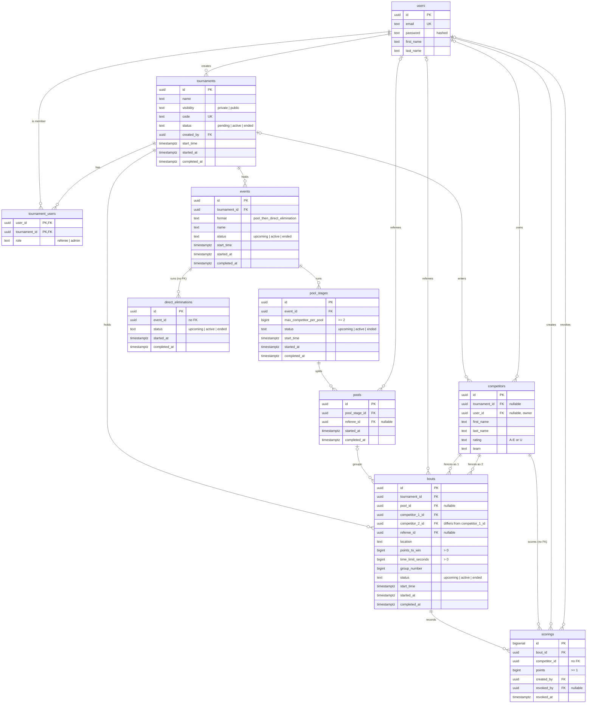

# boutline

Monorepo: `frontend/` is Next.js 16 + React 19 + Tailwind 4, `backend/` is a Go +
Fiber API with Postgres, `docs/` holds design specs.

- [Prerequisites](#prerequisites)
- [Setup](#setup)
- [Running](#running)
- [Databases and migrations](#databases-and-migrations)
- [Deployment](#deployment)

Every command below runs from the repo root. `make help` lists them all;
[backend/README.md](backend/README.md) goes deeper on the API's architecture,
configuration, and testing.

## Prerequisites

| Tool           | Version | Needed for                               |
| -------------- | ------- | ---------------------------------------- |
| Bun            | 1.3.5   | The only package manager for `frontend/` |
| Node.js        | 22 LTS  | Next.js tooling targets Node             |
| Go             | 1.25.5+ | `backend/`                               |
| Docker Desktop | any     | The backend dev stack (API + Postgres)   |
| Atlas CLI      | any     | Writing migrations                       |
| golangci-lint  | any     | `make be-lint`                           |

Postgres itself is not on that list — it runs in Docker alongside the API, so
there is nothing to install or start by hand.

**macOS**

```bash
# Bun installs to ~/.bun — add ~/.bun/bin to PATH if the installer doesn't
curl -fsSL https://bun.sh/install | bash -s "bun-v1.3.5"

brew install node@22 go golangci-lint ariga/tap/atlas
brew install --cask docker
```

Homebrew's `node@22` is keg-only, so put it on your PATH:

```bash
echo 'export PATH="/opt/homebrew/opt/node@22/bin:$PATH"' >> ~/.zshrc
exec zsh
```

**Linux / Windows**

Bun: `curl -fsSL https://bun.sh/install | bash`. On Windows use WSL2 — Bun's
Windows build is not what CI runs. Get the rest from your package manager or from
[nodejs.org](https://nodejs.org), [go.dev/dl](https://go.dev/dl),
[docs.docker.com/engine/install](https://docs.docker.com/engine/install/), and
[atlasgo.io](https://atlasgo.io/getting-started#installation).

The `make` shortcuts need `make` itself: on macOS run `xcode-select --install`,
on Linux install `build-essential` or your distro's equivalent.

## Setup

```bash
git clone https://github.com/GenerateNU/boutline.git
cd boutline
make setup   # bun install + go mod download
make dev     # API + database in Docker, then the frontend dev server
```

- Frontend: [http://localhost:3000](http://localhost:3000)
- API: [http://localhost:8000](http://localhost:8000), Swagger UI at
  [/docs](http://localhost:8000/docs), spec at `/openapi.json`

`make dev` starts Docker Desktop itself if it is not already running, waits for
the daemon, brings the API and its Postgres up detached, applies migrations, then
runs the frontend in the foreground. Stop the frontend with Ctrl-C and the stack
with `make be-down`.

Never run `npm`, `yarn`, or `pnpm` in `frontend/` — they write a competing
lockfile. No environment variables are required: every backend value has a
default (listed in [backend/README.md](backend/README.md)) and the frontend reads
none. `.env*` files are gitignored.

## Running

| Command      | What it does                          |
| ------------ | ------------------------------------- |
| `make dev`   | The whole stack, ready to work in     |
| `make test`  | Both test suites                      |
| `make check` | Everything CI would run, before a PR  |

Per stack: `fe-dev`, `fe-build`, `fe-lint`, `fe-typecheck`, `fe-test`, `fe-check`
for the frontend, and `be-up`, `be-down`, `be-logs`, `be-build`, `be-test`,
`be-lint`, `be-check` for the backend.

[Frontend CI](.github/workflows/frontend-ci.yml) and
[Backend CI](.github/workflows/backend-ci.yml) run the matching half of `check`
on every PR touching that stack. The backend workflow goes further than
`be-check` does: it also builds the Docker image and fails if the gorm models
and `backend/migrations` have drifted apart.

One thing that looks like broken setup but isn't: `fe-typecheck` must run
`next typegen` before `tsc`. Bare `tsc` reports errors CI never sees, since
`src/app/layout.tsx` uses a `LayoutProps` global that typegen writes into
`.next/types`.

## Databases and migrations

The database is a container in the backend's compose stack, so `make dev` is all
it takes to get one. Two commands cover the rest:

| Command           | What it does                                              |
| ----------------- | --------------------------------------------------------- |
| `make db-shell`   | psql shell on the dev database                            |
| `make db-reset`   | Wipe it and bring it back with migrations applied (asks first) |

Its port is deliberately not published, so a Postgres already running on your
machine at `:5432` does not clash with it.

Atlas owns the schema, generating migrations by diffing the gorm models:

```bash
make migrate-new NAME=create_examples  # write the next migration
make migrate-status                    # what the dev database has applied
```

`make be-up` applies pending migrations before the API starts, so there is no
separate apply step.

`migrate-new` needs the Atlas CLI and a running Docker daemon — Atlas spins up a
throwaway Postgres to normalise the schema before diffing. A new feature's model
must be registered in `backend/cmd/atlasloader/main.go` or it will never get a
migration. Read the generated SQL before committing it;
[backend/README.md](backend/README.md) has the full workflow.

### Schema

The schema as of `20261024043137_add_competitor_owner`. Every table also has
`created_at` and `updated_at`, left out below. Relationships labelled "no FK"
are references the code relies on but the database does not enforce with a
foreign key.



## Deployment

The backend and its Postgres deploy to Generate's shared DigitalOcean droplet,
and the frontend to Vercel. Publishing a GitHub Release ships production. Every pull request gets its own preview backend, preview database,
and Vercel frontend preview. See [DEPLOYMENT.md](DEPLOYMENT.md) for
day-to-day use and [deploy/](deploy/) for the droplet.
