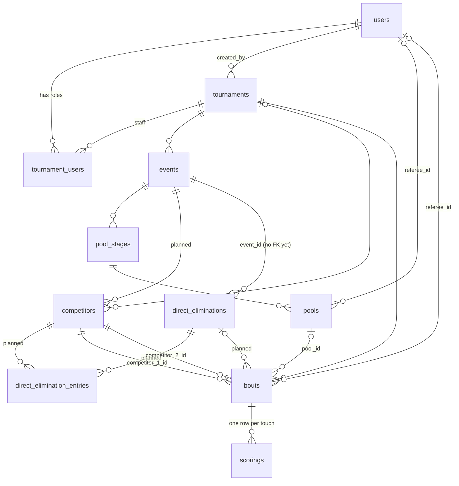

# Boutline design

Boutline runs fencing tournaments end to end: an organizer sets up a tournament and
its events, fencers are placed into pools, pool results seed a direct-elimination
tableau, and referees score every bout live from a phone while everyone else
follows along. This document describes every feature: what it is for, its data,
its API, its rules, and its screens. It also records how far each one is built.

Each feature is tagged:

- **Built**: working end to end against the real API.
- **Partial**: the backend exists but the UI is placeholder, or the reverse.
- **Planned**: specified here, not yet in code. Treat these sections as the
  proposed design and amend them through review.

When code and this document disagree, fix one of them in the same PR.

---

## 1. Users and roles

| Role | Scope | Can |
| --- | --- | --- |
| Spectator / fencer | public, no account needed | browse tournaments, events, pools, tableau, results, live scores |
| Account holder | global | create tournaments, be added as staff |
| Tournament **admin** | one tournament | edit it, run its lifecycle, manage events, competitors, staff, pools, brackets |
| Tournament **referee** | one tournament | start, score and end bouts they are assigned to |

Roles are per tournament (`tournament_users.role`: `admin` | `referee`). There is no
global superuser. A user can hold different roles in different tournaments.

**Status:** roles are stored, but only competitor delete checks them. Every other
mutating route accepts any logged-in user (see §15).

---

## 2. Domain model

Links labelled "planned" come from one competitor per event (§8) and the bracket
plan (§10).

| Entity | Meaning |
| --- | --- |
| **User** | a person with an account (organizer, referee) |
| **Tournament** | a dated competition with a join code, e.g. "Boston Fall Open" |
| **TournamentUser** | a user's staff role in one tournament |
| **Event** | one competition inside a tournament, e.g. "Y14 Men's Foil" |
| **Competitor** | a fencer entered in one event, with that weapon's rating, club, seed, check-in and withdrawal (one row per event is planned; today rows belong to a tournament) |
| **PoolStage** | the round-robin round of an event |
| **Pool** | one group of fencers within a pool stage, with a referee |
| **DirectElimination** | the knockout round of an event |
| **DirectEliminationEntry** | a fencer who made the cut into a tableau, with their seed (planned) |
| **Bout** | one match between two competitors |
| **Scoring** | one touch awarded in a bout. Undo marks it revoked, never deletes it |

All IDs are UUIDs except `scorings.id` (bigserial, so touches sort by insert order).

---

## 3. Lifecycles

Every stateful entity moves forward only. Transitions are guarded in SQL
(`UPDATE … WHERE status IN (…)`), so two racing requests cannot both succeed; the
loser gets `409`.

| Entity | States | Transitions | Built? |
| --- | --- | --- | --- |
| Tournament | `pending → active → end` | `POST /tournaments/{id}/start`, `/complete` | Built |
| Event | `upcoming → active → ended`, or `upcoming → cancelled` | none yet | **Planned**: start when its first stage starts, end when its DE ends; an admin can cancel it while `upcoming` |
| PoolStage | `upcoming → active → ended` | none yet | **Planned**: start when the first pool bout starts, end when all pool bouts end |
| Pool | no status column | none | **Planned**: derive from its bouts; `started_at` / `completed_at` exist but are never written |
| DirectElimination | `upcoming → active → ended` | `POST /direct-eliminations/{id}/start`, `/complete` | Built |
| Bout | `upcoming → active → end` | `POST /bouts/{id}/start`, `/end` | Built |

What each state allows:

- **Tournament**: name, visibility and start time are editable while `pending` or
  `active`. Bouts can only be created and started while `active`. `end` freezes the
  tournament row (other tables are not frozen yet; see §15).
- **Event / PoolStage**: editable and deletable only while `upcoming`.
- **DirectElimination**: editable while `upcoming` or `active`.
- **Bout**: editable only while `upcoming`; deletable while `upcoming` or `end`.
  Starting a bout requires an active tournament and an assigned referee.
  **Planned:** a bout that belongs to a pool or a tableau is never deletable. Its
  parent creates and removes it, and deleting an ended one would change pool
  results or strand the bracket. Only a free-standing bout stays deletable, and
  only while `upcoming`.

Derived transitions (a pool stage ending when its last bout ends, a DE round
advancing, an event ending with its DE) are checks of the form "are all the
siblings done?". Two bouts ending at once can each see the other still active and
both skip the transition, which stalls the parent for good. So ending a bout locks
its parent row (`SELECT … FOR UPDATE` on the pool stage or DE) in the same
transaction, and runs the derived transition before committing.

The one exception to forward-only is correcting a result (§11.4): an admin can
amend an ended bout. That does not move any status backwards.

> Vocabulary is inconsistent: tournaments and bouts end in `end`, everything else in
> `ended`. Unify to `ended` in one migration before more code depends on it.

---

## 4. Accounts and authentication

**Status:** authentication Built; authorization Planned.

### Built
- `users`: `id`, `email` (unique, lowercased, validated with `net/mail`), `password`
  (bcrypt, 1–72 bytes), `first_name`, `last_name`, timestamps.
- `POST /api/v1/auth/signup` (409 on duplicate email) and `POST /auth/login` both
  return `{token, user}`. The token is a JWT carrying the user ID, valid 24 hours
  (`user.UserTokenTTL`).
- The auth middleware makes reads public and every other method require
  `Authorization: Bearer <token>`. An operation can override this; `GET /users` and
  `GET /users/{id}` require a token. The verified ID is read with `user.UserIDFrom`.
- `GET /users?q=` (trigram search on full name), `GET /users/{id}`,
  `PATCH /users/{id}` (names only), `DELETE /users/{id}` (409 if the user created a
  tournament, referees a bout or pool, or recorded a touch; memberships cascade),
  `GET /users/{id}/tournaments` (tournaments the user is staff on).
- The password is never returned.

### Session in the frontend
The `login` and `signup` Server Actions call the backend and store the token in an
httpOnly, `sameSite=lax` cookie with the token's lifetime, so page scripts never see
it. `src/proxy.ts` moves the cookie into the `Authorization` header on `/api/*`, and
redirects `/admin/*` and `/…/referee` to `/login?next=…` when there is no cookie.

### Planned
- `created_by` (tournament, scoring), `revoked_by` and the acting referee come from
  `UserIDFrom`, not the request body. Today all three are client-supplied.
- Authorization helper `requireRole(tournamentID, admin|referee)` on every mutating
  route (§15 lists the open routes).
- `PATCH` and `DELETE /users/{id}` only for the caller's own ID. Today any logged-in
  user can rename or delete any other user.
- Rate-limit login and the join-code lookup (§5) in Redis.
- Email and password change (TODO in `user/types.go`).

---

## 5. Tournaments

**Status:** backend Built. UI Partial: the public list works, everything else is
placeholder.

### Data
`tournaments`: `name` (1–120), `visibility` (`private` | `public`, default private),
`code` (unique 6-char join code), `status`, `created_by` (user), `start_time`,
`started_at`, `completed_at`.

### Join code
Six characters from `ABCDEFGHJKMNPQRSTUVWXYZ23456789`, which leaves out the
look-alikes 0/O and 1/I/L. Generated with `crypto/rand` and retried up to five times
on collision. Lookup is case-insensitive and trims whitespace:
`GET /tournaments/code/{code}`. Fencers and spectators join a private tournament by
typing the code.

### API (`/api/v1/tournaments`)
| Method | Path | Notes |
| --- | --- | --- |
| POST | `/` | create; the code is server-generated |
| GET | `/?q&status&limit&offset` | fuzzy name search, status filter |
| GET | `/{id}` | |
| GET | `/code/{code}` | join by code |
| PATCH | `/{id}` | name, visibility, start_time; 409 once ended |
| POST | `/{id}/start` | `pending → active` |
| POST | `/{id}/complete` | `active → end` |

Tournaments cannot be deleted (on purpose; soft delete is under consideration).

### Screens
- **`/tournaments`** (Built): a server-rendered list with a search box
  (a plain GET form that works without JS; with JS it updates `?q=` after a 300ms
  debounce), 20 per page, Previous/Next links, a status badge
  (Upcoming / Active / Ended), and empty states for "no results" and "no
  tournaments". Location is hardcoded as "City, Country", and the Filter button is
  inert.
- **`/tournaments/[id]`** (Placeholder): tabs Overview · Fencers · Clubs · Events.
  Overview should show name, venue, date and time, contact, the live events, and a
  join-code prompt for private tournaments. None of it calls the API yet.

### Planned
- Fields the creation form already collects but the backend lacks: location
  (city/state), venue, fees, sanctioning authority (askFRED, USA Fencing, FIE,
  Other), description. Add them to `tournaments`.
- Enforce visibility: private tournaments are hidden from the public list and
  readable only by staff or by someone holding the code. The check has to cover
  every read that returns tournament data, not just the tournament routes.
  `/events`, `/competitors`, `/bouts`, `/scoring/…` and the pool and DE routes are
  top level and don't require a tournament filter. Today `GET /competitors?q=`
  searches every tournament at once. Holding the code needs to be remembered
  (a cookie listing the tournament IDs the viewer unlocked), and the code lookup
  is rate-limited: there are about 887M codes, few enough to enumerate.
- The creator becomes an `admin` member automatically on create (today they don't).
- Starting a tournament requires at least one event. Completing it requires every
  event to be `ended` or `cancelled`, so an event that never ran doesn't block it.

---

## 6. Tournament staff

**Status:** backend Built (no UI).

`tournament_users`: primary key `(user_id, tournament_id)`, `role`. The rows are
deleted when either the user or the tournament is deleted.

| Method | Path | |
| --- | --- | --- |
| POST | `/tournaments/{id}/users` | add `{user_id, role}`; 409 if already a member |
| GET | `/tournaments/{id}/users` | list |
| PATCH | `/tournaments/{id}/users/{user_id}` | change role |
| DELETE | `/tournaments/{id}/users/{user_id}` | remove |

### Planned
- Guard against removing or demoting the last admin.
- Block staff changes once the tournament has ended.
- The creation form's free-text "Admins" field (comma-separated emails) resolves
  emails to users and adds them as admins.
- A Staff screen under the tournament for admins.

---

## 7. Events

**Status:** backend Partial (CRUD only), UI Placeholder.

### Data
`events`: `tournament_id`, `name` (1–200), `format` (only
`pool_then_direct_elimination`), `status`, `start_time`, `started_at`,
`completed_at`. Deleting an event also deletes its pool stages.

### API (`/api/v1/events`)
`POST /` (tournament must exist), `GET /?tournament_id&status`, `GET /{id}`,
`PATCH /{id}` and `DELETE /{id}` (both only while `upcoming`).

### Screens (all placeholder data)
- **`/tournaments/[id]/events`**: a hardcoded list of four events with a status chip
  (Past / Live / Upcoming).
- **`/tournaments/[id]/events/[eventId]`**: redirects to the Fencers tab. Tabs are
  Pooling · Fencers · Tableau · Results.

### Planned
Event attributes the creation form already collects, to add as columns:

| Field | Values |
| --- | --- |
| type | individual, team |
| weapon | foil, épée, sabre |
| gender | men, women, mixed (both boxes checked) |
| age category | Y8, Y10, Y12, Y14, Cadet, Junior, Senior, Veteran, Open |
| rating limit | e.g. "D and under", "Open" |
| seeding | by rating, by ranking points, random |
| format | `direct_elimination` (new), `pool_then_direct_elimination` |
| qualifier | boolean |
| fees, referees | money; list of referee users |
| pool touches, pool time | default 5 touches, 180 s |
| DE touches, DE periods | default 15 touches, three 180 s periods; youth and veteran events often fence DE to 10 |

Rules:
- An event is created together with its stages: a `pool_then_direct_elimination`
  event gets one `pool_stage` and one `direct_elimination`; a `direct_elimination`
  event gets only the DE.
- Event status follows its stages: `active` when the first stage starts, `ended`
  when the DE completes. `cancelled` is set by an admin while `upcoming`.
- Generated bouts copy their touches and time limit from the event, so §9 and §10
  never hardcode them.
- Deleting an event removes its pool stage, pools, their bouts and its DE in one
  transaction. Today the cascade stops at `bouts.pool_id` (`ON DELETE RESTRICT`),
  so deleting an upcoming event that already has pools fails with a 500. The DE
  row is left behind because `direct_eliminations.event_id` has no foreign key.
- The events list gains search and a weapon/gender/age filter, and shows
  Past / Live / Upcoming from `status`.

---

## 8. Competitors and clubs

**Status:** backend Partial, UI Placeholder.

### Data
`competitors`: `tournament_id` (nullable for now), `first_name`, `last_name`,
`rating` (`A`–`E`, `U` = unrated, default U), `team` (free-text club, `''` when
none). There is no clubs table: a club is the distinct `team` values.

### API (`/api/v1/competitors`)
`POST /`, `GET /?q&rating&team` (fuzzy name search), `GET /{id}`, `PATCH /{id}`
(an empty `team` clears it), `DELETE /{id}` (hard delete), and
`GET /search/teams?q&tournament_id`, which returns each club with its
`competitorCount`.

### Screens (placeholder)
Tournament **Fencers** and **Clubs** tabs and the event **Fencers** tab are static
text.

### Planned
- **One competitor per event** (#77): a competitor row belongs to exactly one event
  (`event_id`, required). A person fencing foil and épée has two rows, one per
  event. Because ratings are per weapon (`B24` in foil, `U` in épée), each row
  carries its own rating, seed and check-in. There is no entries table.
- New columns: `event_id`, `gender`, `birthdate`, `primary_club` and
  `secondary_club` (both nullable), `division` (home state), `member_number`
  (optional, unique within an event; its authority comes from the tournament),
  `rating_year` (e.g. 24 in `C24`), `seed`, `checked_in_at`, `withdrawn_at`.
  `team` is deprecated in favour of `primary_club`.
- **Withdrawal**: `withdrawn_at` marks a fencer who leaves the event (injury,
  exclusion, no-show after check-in). §9 and §10 say what it does to their bouts.
- Club names are free text, so "NYAC" and "New York AC" count as two clubs. Club
  separation (§9) and the Clubs tab compare a normalised key (case, whitespace and
  punctuation folded) until there is a clubs table.
- Filter lists by tournament and event (neither is possible today).
  `tournament_id` stays on the row so tournament-wide lists don't need a join.
- The tournament Fencers tab lists people, not rows, so it groups a person's rows
  across events by `member_number`, falling back to name and primary club when it
  is missing.
- **Import** (the dropzones on the creation form): askFRED and USA Fencing CSV/XML
  exports create one competitor row per event entered, with name, club and
  rating.
- **Check-in**: admins mark fencers present. Only checked-in fencers are placed into
  pools.
- Rating includes the year (e.g. `B24`); this matters for seeding.
- Competitors are not linked to users. A `competitors.user_id` (nullable) would let
  a fencer follow their own bouts, and would let the referee check refuse a user
  who is fencing in the bout.
- Fencers tab: searchable list with rating and club. Clubs tab: clubs with counts,
  which drill down to their fencers.

---

## 9. Pools

**Status:** backend Partial (CRUD only, no generation or results), UI Placeholder.

### Data
- `pool_stages`: `event_id`, `max_competitor_per_pool` (≥ 2), `status`, `start_time`.
- `pools`: `pool_stage_id`, `referee_id`, `started_at`, `completed_at`.
- `bouts.pool_id` links a pool's bouts to the pool.

### API
- `/api/v1/pool-stages`: CRUD; edit and delete only while `upcoming`; delete is
  blocked once any of its pools has bouts.
- `/api/v1/pools`: CRUD; `PATCH` changes only the referee; delete is blocked
  (409) when the pool has bouts.

### Screen
**Pooling tab:** a list of pool bouts (round, names, score) linking to each bout.
The data is a hardcoded fixture shared by every event.

### Planned: pool data
- `pools.number` (≥ 1, unique per pool stage) labels the pool, and `pools.strip`
  is its strip assignment.
- `bouts.slot` (≥ 1, unique per pool) is a pool bout's place in the pool's bout
  order. Bouts created in one batch share a `created_at`, so the order needs a
  column. The same column holds a DE bout's bracket position (§10); a bout is in a
  pool or a tableau, never both.
- A pool's fencers are the competitors in its bouts. There is no pool-fencers
  table.
- A pool's bouts copy its strip (`location`), referee and number (`group_number`).
  Editing any of those on the pool updates its upcoming bouts in the same
  transaction, so they never go stale.

### Planned: pool generation
Generation is three steps, all admin only and only while the pool stage is
`upcoming`. The admin reviews and adjusts the proposal before anything is saved.
Creating pools creates bouts, which requires an `active` tournament (§11.1), so
pools are generated after the tournament starts.
1. **Propose:** `POST /pool-stages/{id}/proposed-pools` takes the event's
   checked-in fencers (an optional `competitor_ids` overrides the list, and every
   id must belong to the event) and returns pools without saving:
   - Seed by the event's `seeding` rule (rating, then rating year, then random
     tiebreak).
   - Pool count = `ceil(n / max_competitor_per_pool)`, with sizes as equal as
     possible (e.g. 20 fencers, max 7: pools of 7-7-6).
   - `n < 2` is a 400: a pool needs two fencers. `max_competitor_per_pool` is capped
     at 12, the largest size with a standard bout order.
   - Snake the seeds across the pools (1→A, 2→B, 3→C, 4→C, 5→B, …).
   - **Club separation:** move fencers between pools at the same seeding level to
     minimise same-club pairs within a pool, comparing normalised club names (§8).
2. **Create:** `POST /pools` takes the adjusted pools and creates each one with
   every round-robin bout, in the standard bout order for its size so no one
   fences back-to-back. Pool bouts use the event's pool touches and time (§7).
3. **Re-seat:** `PATCH /pools/{id}` with `fencers` replaces a pool's fencers and
   regenerates its bouts, while none of them has started. This depends on the
   server-side scoring rules (§11.4): today an `upcoming` bout can hold touches, and
   deleting it then fails on the scorings FK.

Create and re-seat lock the pool stage row (`SELECT … FOR UPDATE`) and run every
check inside that transaction. Without the lock, two requests can seat the same
fencer in two pools, or re-seat a pool that has just started.

### Planned: pool results
`GET /pool-stages/{id}/results` returns each pool's grid and standings plus the
overall ranking, computed from ended bouts. It is also the read the Pools tab
uses, so there is no separate pool-board resource.

| Column | Meaning |
| --- | --- |
| V | victories |
| M | bouts fenced |
| V/M | win ratio, the primary sort key |
| TS / TR | touches scored / received |
| Ind | indicator = TS − TR, the second sort key |

Overall ranking: V/M desc, then Ind desc, then TS desc, otherwise tied. That
ranking seeds the DE, so the results endpoint and the DE draw (§10) share one
standings function. Each pool screen shows the classic grid (fencer × fencer,
`V5` / `D3` cells) plus the summary columns.

V comes from `bouts.winner_id` (§11.1), not from comparing scores. A bout won at
time can be `V3`–`D2`, and a priority win can be `V2`–`D2`.

**Withdrawal during pools.** When a fencer withdraws or is excluded (§8), every
bout of theirs is annulled, fenced or not: `bouts.annulled_at` is set, the bout is
left out of everyone's V, M, TS and TR, and the fencer leaves the overall ranking.
An annulled bout keeps its status, and counts as finished so the stage can still
end.

**Pool stage end.** The stage ends when every bout in it is `end` or annulled, and
it has at least one pool. That check runs under the stage row lock (§3).

---

## 10. Direct elimination (tableau)

**Status:** backend Partial (round status only, no bracket), UI Placeholder.

### Data
`direct_eliminations`: `event_id` (no foreign key yet), `status`, `started_at`,
`completed_at`.

### API (`/api/v1/direct-eliminations`)
CRUD plus `POST /{id}/start` (`upcoming → active`) and `/complete` (`active → ended`).

### Screen
**Tableau tab:** the same placeholder bout list as Pooling.

### Planned: bracket
- Add a FK `direct_eliminations.event_id → events`.
- `direct_elimination_entries(direct_elimination_id, competitor_id, seed)`: the
  fencers who made the cut, with `seed` unique within a tableau. They are written
  once at the draw and never recomputed, so a pool score corrected afterwards
  cannot move anyone, and they are the only record of who has a bye. They are
  stored rather than recomputed from the pool ranking so an organizer can leave
  out a fencer who withdraws after pools, or correct a seed, without touching
  pool results.
- Add `bouts.direct_elimination_id` and `bouts.round_size` (fencers in the round:
  64, 32, …, 2 is the final). A DE bout reuses `bouts.slot` (§9) as its 1-based
  position in the round, top to bottom, with `competitor_1` as the top fencer. The
  bouts at slots 2k−1 and 2k feed slot k of the next round.
  `(direct_elimination_id, round_size, slot)` is unique.
- `POST /direct-eliminations/{id}/generate`, admin only, while `upcoming`, and only
  once the event's pool stage has ended (which already requires every pool to have
  ended). It takes the pool ranking, applies an optional cut (e.g. advance the top
  80%), breaks remaining ranking ties at random, and writes the entries. Fencers
  tied at the cut line all advance, so the cut can let in more than its
  percentage; the random tiebreak runs only after the cut. The bracket size is the
  next power of two ≥ n. Seeds are placed in standard bracket order (1 v 64,
  32 v 33, …), and the top seeds receive byes for the empty positions.
- `n < 2` after the cut is a 400. One fencer has no final to fence, so the DE
  would never complete.
- The draw creates only first-round bouts, one per position with two fencers; a
  bye has no bout. A DE bout is only ever created with both fencers known, so
  `competitor_1_id` and `competitor_2_id` stay required.
- A next-round bout is created as soon as both of its feeders are known: the
  winners of the bouts at slots 2k−1 and 2k, or a bye fencer and one winner in the
  second round. Waiting for the whole round would hold up every fencer behind the
  slowest bout.
- Advancement runs in the transaction that ends the bout, under the DE row lock
  (§3), so a crash cannot end a bout without advancing its winner, and two
  neighbouring bouts ending at once cannot both miss the other's result. The
  insert uses `ON CONFLICT DO NOTHING` on the unique slot index. A bare unique
  violation would abort the whole transaction, bout end included.
- The final ending completes the DE and the event. `POST /{id}/complete` is
  refused (409) while the final has not ended.
- A DE bout can only start while its DE is `active`.
- A fencer who withdraws during the DE (§8) loses their current bout by forfeit
  (§11.4), and their opponent advances.
- DE bouts use the event's DE touches and periods (§7), with a 1-minute break.
- Final placings: 1, 2, 3 and 3 (no bronze bout), then by round of elimination,
  ties within a round broken by seed.
- `GET /events/{id}/tableau` (public) returns every round from the bracket size
  down to the final, each with its bouts in slot order and each fencer's seed.
  Rounds not yet created come back with no bouts.
- The Tableau tab shows the bracket by round, with live scores on active bouts.
  Positions without a bout (byes, rounds not yet created) are drawn empty.

---

## 11. Bouts and live scoring

### 11.1 Bouts
**Status:** backend Built.

`bouts`: `tournament_id`, `pool_id?`, `referee_id?`, `competitor_1_id`,
`competitor_2_id` (must differ), `points_to_win` (> 0), `time_limit_seconds?`,
`location?` (strip number, max 200 chars), `group_number`, `start_time`,
`status`, `started_at`, `completed_at`.

| Method | Path | Rules |
| --- | --- | --- |
| POST | `/bouts` | tournament must be active; the pool must belong to the same tournament |
| GET | `/bouts?tournament_id&pool_id&status` | |
| GET | `/bouts/{id}` | |
| PATCH | `/bouts/{id}` | only while `upcoming` |
| POST | `/bouts/{id}/start` | tournament active, referee assigned, `upcoming → active` |
| POST | `/bouts/{id}/end` | `active → end` |
| DELETE | `/bouts/{id}` | only while `upcoming` or `end` |

**Planned: bout result.** The winner can't always be read off the touches: a bout
can end at time with no one at `points_to_win`, on a priority minute with the
score tied, or by forfeit with no touches at all. So `/end` stores the result on
the bout:

| Column | Meaning |
| --- | --- |
| `winner_id` | one of the two competitors; required once `end` |
| `competitor_1_score`, `competitor_2_score` | the live touch totals at the moment it ended |
| `end_reason` | `touches`, `time`, `priority`, `forfeit` |
| `annulled_at` | set when a withdrawal annuls the bout (§9) |

Pool results, DE advancement and placings read these columns, never a fresh sum of
touches.

**Planned: bout integrity.**
- A CHECK makes `pool_id` and `direct_elimination_id` mutually exclusive.
- Both competitors must belong to the bout's event, and the referee must be a
  staff member of its tournament.

The **bout page** (`…/bout/[boutId]`) shows two score tiles, a "Referee view" button
and a touch log. It is fed by the placeholder fixture, but its referee link goes to
the real API.

### 11.2 Scoring API
**Status:** Built.

`scorings`: `bout_id`, `competitor_id`, `points` (≥ 1, default 1), `created_by`,
`revoked_at`, `revoked_by`. A touch is never deleted. Undo sets `revoked_at`.

| Method | Path | |
| --- | --- | --- |
| POST | `/scoring` | award a touch |
| GET | `/scoring/{id}` | |
| PATCH | `/scoring/{id}` | change points or competitor; 409 if revoked |
| POST | `/scoring/{id}/revoke` | undo; 409 if already revoked (race-safe) |
| GET | `/scoring/match/{bout_id}?include_revoked` | live touches, paginated |
| GET | `/scoring/match/{bout_id}/history` | every touch, newest first, with running `competitor_1_score` / `competitor_2_score`; never paginated |

### 11.3 Referee screen (`…/bout/[boutId]/referee`)
**Status:** Built, apart from the auth gate. This is the only screen fully wired to
the backend.

**Phases**

| Phase | When | Referee sees |
| --- | --- | --- |
| `not-started` | bout `upcoming` | "Start match" |
| `scoring` | active, no winner | a large "Touch {name}" button per fencer, Undo, a match-point banner when a side is one touch away (both sides can be) |
| `confirming` | a side reached `points_to_win` | "{winner} wins A–B", one confirm button per fencer, Undo |
| `over` | bout `end` | the winner banner; no controls |

**Rules**
- The score is the sum of a fencer's live (unrevoked) touches. The winner is the
  first side to reach `points_to_win`.
- **One action in flight.** Touch, undo, start and end go through a single queue
  that refuses new input while a request is pending. Touches show immediately as
  "Saving…" rows (optimistic) and settle when the server replies.
- **Undo** revokes the most recent live touch, whichever fencer it belongs to.
  Available in `scoring` and `confirming`.
- **Two-party confirmation.** The bout ends only when both fencers have confirmed
  the same score. Each confirmation records the score version it was given
  against, so a touch or undo in between cancels earlier confirmations.
- **End guard.** The client refuses to end the bout if the number of touches it has
  confirmed differs from the tally it is ending on ("The score changed before the
  bout could end").
- **Recovery.** Any failed request shows an error, then reloads the bout, touches
  and history from the server, which wins.
- **History.** A newest-first log of time, "Touch {name}", running score
  (fencer 1 – fencer 2), with revoked touches kept and labelled "Revoked".
- Start assigns a referee if none is set, then starts the bout.

**Temporary bypass:** the page sits behind the login gate, but it still sends a
fixed seeded user (`FALLBACK_SCORER_ID`, Alex Morgan) as scorer and referee
instead of the logged-in user. The real referee checks are commented out with
TODOs. **Any logged-in user can score any bout** until scoring takes the actor from
the session and checks the referee role (§4).

### 11.4 Planned scoring features
- Server-side scoring rules: reject touches, edits and revokes on bouts that are not
  `active`, and touches for competitors outside the bout. Refuse a touch, or a
  points edit, that would take a side past `points_to_win`. Today only the client
  enforces this, and a touch revoked after the bout ends silently changes its
  result.
- Server-side end rules: `/end` takes the winner and reason, and checks them
  against the live tally, under the bout row lock. `touches` needs the winner at
  `points_to_win`; `time` needs the winner ahead; `priority` allows a tie;
  `forfeit` checks nothing. The client's two-party confirmation stays as UX, but the
  server makes the decision.
- **Result correction.** `POST /bouts/{id}/correct` (admin only) replaces an ended
  bout's scores and winner and records who changed it, from what, and why. A pool
  bout can be corrected until the DE is drawn, since the draw freezes the
  ranking (§10). A DE bout can be corrected while its next-round bout is still
  `upcoming`; that bout is then rebuilt with the corrected winner.
- Idempotency: a client-generated `request_id` on `POST /scoring` (unique per bout),
  so a retried touch is not double-counted.
- Bout clock: start/stop, `time_limit_seconds` countdown, periods and the break for
  DE. At time with a tied score, priority is assigned at random and the bout goes
  one more minute.
- Cards: yellow (warning), red (penalty touch to the opponent), black (exclusion),
  recorded as scoring rows with a `kind`. A yellow card is worth no touches, so
  the `points ≥ 1` check applies only to `touch` and `red`, and the score sums only
  those kinds. A black card withdraws the fencer from the event (§8).
- Double touches (épée): one action awarding both fencers. A double at one touch
  from the end (4–4, 14–14) cannot produce a winner the "first to
  `points_to_win`" rule understands (§17).
- Live updates for spectators (SSE or polling against `/history`). Redis is
  already connected and is the obvious pub/sub channel.
- Withdrawal / forfeit / abandonment as bout results.

---

## 12. Results

**Status:** Placeholder (static Results tab).

**Planned:** `GET /events/{id}/results` returns the final placings (from the DE,
or from the pool ranking for fencers cut after pools) with name, club, rating
and place. Admins can export them in askFRED / USA Fencing format. The Results tab
shows the table, and the tournament overview links each ended event's podium.

---

## 13. Organizer console

**Status:** Placeholder.

- **`/admin`**: a hub with "View tournaments" and "New tournament", plus inert menu
  buttons (tools, reports, view, save).
- **`/admin/tournaments`**: three hardcoded tournaments. **Planned:**
  `GET /users/{me}/tournaments`.
- **`/admin/tournament/new`**: a full form for tournament fields (§5), import
  dropzones (§8), admins (§6), and any number of event blocks (§7). **Placeholder:**
  submit discards the data and navigates away; the dropzones ignore their files;
  events cannot be removed.

**Planned flow:** submit creates the tournament, then its events, then imports
competitors and adds staff. It shows per-row errors and lands on the new
tournament. On the day, the admin runs check-in, starts the tournament, generates
pools (which creates bouts, so it needs the tournament `active`), assigns
referees, and generates the DE once pools end.

---

## 14. Cross-cutting

### API conventions
- Routes live under `/api/v1`, except `/healthcheck`. The OpenAPI spec is at
  `/openapi.json` and Swagger UI at `/docs`.
- Errors are RFC 9457 problem details. `400` invalid input from the service, `422`
  schema validation from Huma, `404` not found, `409` conflict or duplicate, and
  `500` with a generic message for anything else.
- Lists return `{data, total, limit, offset}`; `limit` defaults to 20 (max 100).
  The scoring history is the exception: always complete, never paginated. An
  `ids` filter (up to 100, e.g. a viewer's pinned items) returns every listed row,
  so its `limit` defaults to the number of ids rather than 20.
- Fuzzy search uses `pg_trgm` `word_similarity` on names and clubs. Terms shorter
  than 2 characters fall back to a prefix `ILIKE`.
- The frontend talks to the API through `apiRequest` (`/api/v1` is proxied by
  `next.config.ts`). Server Components fetch with `no-store`.

### Pinning
A viewer can pin fencers and bouts to follow them. Pins live in the browser's
`sessionStorage`, never in the database. The pinned view fetches each entity type
in one request with the `ids` filter on `/competitors` and `/bouts`. The
`/pinned` page is a scaffold.

### Concurrency
Network code must survive retries and races:
- State transitions are conditional updates, as described in §3.
- Revoke and edit of a score are conditional on `revoked_at IS NULL`.
- No version columns, idempotency keys or transactions exist yet. Multi-step
  operations such as pool generation and DE advancement **must** run in one
  transaction.
- "Is every sibling done?" checks (stage end, DE advancement, event end) lock the
  parent row first. A conditional update can't protect them, because each request
  only writes its own bout (§3).
- Inside a transaction, an expected duplicate uses `ON CONFLICT DO NOTHING`. A
  raised unique violation aborts everything before it in the transaction.

### Infrastructure
Postgres (schema owned by Atlas migrations generated from the GORM models), Redis
(connected but unused), Docker dev stack (`make dev-up`), seeds at
`backend/seeds/seed.sql` (fixed UUIDs, idempotent).

---

## 15. Known gaps and inconsistencies

Found by reading the code, not by running it. Fix these before building on the
features they touch.

1. **No authorization.** Mutating routes require a login, but only competitor
   delete checks the caller's tournament role. Any logged-in user can start, end,
   edit or delete pools and pool stages. The planned pool create, re-seat and
   propose endpoints (§9) must not ship before the `requireRole` helper (§4).
   `created_by` on tournament create and on scoring, and `revoked_by`, are still
   taken from the request body. `PATCH` and `DELETE /users/{id}` accept any
   logged-in user, for any ID.
2. **Scoring has no server-side rules:** it accepts touches on upcoming or ended
   bouts and for competitors outside the bout (`scorings.competitor_id` has no FK).
3. Status words differ: `end` (tournament, bout) vs `ended` (event, stages).
4. JSON casing differs: snake_case for tournament, event, bout and scoring;
   camelCase for user and competitor.
5. Event and pool stage have no transitions; their `active` / `ended` states are
   unreachable.
6. `direct_eliminations.event_id` has no foreign key.
7. Deleting a bout with touches, or a competitor that appears in a bout, probably
   returns 500 instead of 409 (the FK error isn't translated).
8. `GET /scoring/match/{id}` sorts newest first; its description says "in the
   order they were recorded".
9. Ending a tournament doesn't freeze its events, staff or competitors.
10. `max_competitor_per_pool` is stored but nothing reads it.
11. With `points_to_win = 1`, both fencers show as on match point at 0–0.
12. Deleting an upcoming event whose pools have bouts fails with a 500: the cascade
    from events stops at `bouts.pool_id` (`ON DELETE RESTRICT`).
13. Bouts store no winner or final score, and `/end` checks nothing, so it accepts
    a tied or unfinished bout (§11.1).
14. Ended bouts can be deleted, which silently rewrites pool results.
15. Private tournament data is readable through the top-level read routes, e.g.
    `GET /competitors?q=` across every tournament (§5).

---

## 16. Visual language

The UI is a **lofi** pass: monochrome, outlined, light mode only. Polish comes later
through the tokens, so components use tokens, never raw colors.

### Layout
- Mobile-first, one column:
  `mx-auto flex w-full max-w-mobile flex-col gap-10 px-4 py-10` (`max-w-mobile` is
  440px).
- Spacing: `gap-1`/`gap-2` inside a control, `gap-3`/`gap-4` between items in a list
  or section, `gap-10` between page sections.
- Group content with `Section`, whose title is a small uppercase muted label.

### Color tokens (`src/app/globals.css`)
| Token | Use |
| --- | --- |
| `background` / `foreground` | page and text; `foreground` is also the outline color |
| `muted` / `muted-foreground` | hover fills, secondary text, empty states |
| `selected` (blue) | only a chosen state: filled button, toggle on, active tab |
| `destructive` | errors and destructive actions |
| `border`, `input`, `ring` | hairlines, field borders, focus rings |

No Tailwind palette colors. The tournament status badge breaks this today
(`bg-amber-600`, `bg-emerald-600`); status colors become tokens next time it is
touched.

### Type
Geist Sans; Geist Mono for aligned numbers. Body and controls `text-sm`, metadata
`text-xs text-muted-foreground`, at most `font-medium`. Sizes from `text-2xl` up are
reserved for scores and bout banners. Referee scores go up to `text-9xl`.

### Shape and interaction
- `--radius` 0.625rem, with `rounded-sm`…`rounded-xl` derived from it. List cards
  use `rounded-md`; pills (tab nav, icon buttons, avatars) use `rounded-full`. 1px
  `border-foreground`, no shadows.
- Focus `focus-visible:ring-2 ring-ring`; hover `bg-muted`; disabled `opacity-50`.
- Icons from `lucide-react` at `size-4`, `aria-hidden` when decorative.
- Referee touch targets are large (`h-32`), because they are pressed under time
  pressure.

### Components
Primitives live in `src/components/primitives/`: shadcn-generated, restyled, `cva`
variants, `cn`, `data-slot`, behavior from `radix-ui`. A component used by one route
stays in that route's `_components/` until a second route needs it.

---

## 17. Open questions

- Hi-fi design: brand color, dark mode, and whether `selected` stays blue.
- Desktop layouts for the organizer console, which may outgrow 440px.
- Team events (relay scoring to 45) are in the form but have no model.
- Do spectators need accounts (to follow fencers) or stay anonymous?
- Should ratings and rankings come from a USA Fencing lookup instead of import?
- Does the Pools tab show a start time per pool? If not, pools need no
  `start_time` of their own.
- Épée double touch at one touch from the end (4–4, 14–14): annul it, or allow
  5–5? The current rules give a bout no winner in that case, so the scoring
  rules and the `confirming` phase have to pick one.
- May a tournament admin referee and score bouts, or only users with the
  `referee` role?
- Does withdrawing a fencer after the DE draw but before their first bout give
  the opponent a walkover bout, or a bye?
