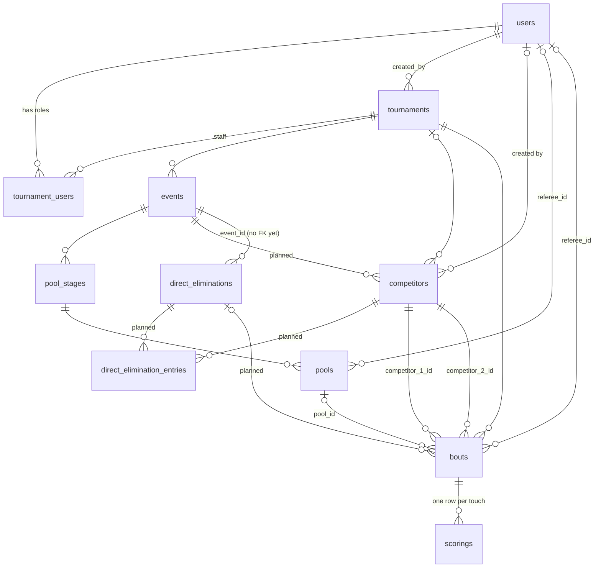

# Boutline design

Boutline runs fencing tournaments end to end. An organizer sets up a tournament
and its events, and fencers are placed into pools. Pool results seed a
direct-elimination tableau, and referees score every bout live from a phone while
everyone else follows along.

This document is the build plan. Each chapter is one step, in the order they are
built: what the step is for, what it consists of, and what must be true before the
next step starts. Steps already built stay in the document as the spec for how they
behave. The appendices hold the reference material every step relies on.

## How to read this

Every chapter and subsection carries a status:

- **Completed**: built and working against the real API.
- **Partial**: some of it is built; the section says which part.
- **Planned**: in the current scope, specified here, not yet in code. Treat it as
  the proposed design and amend it through review.
- **Next in line**: wanted, but outside the current scope. It is the first thing
  picked up once the current scope is done.
- **Out of scope**: wanted, but not planned for the current scope.

| Part | Chapters | Status |
| --- | --- | --- |
| Built | 1 Platform · 2 Data and API · 3 Accounts · 4 Browsing tournaments · 5 Live scoring · 6 Pinning | Completed or Partial |
| Current scope | 7 Identity and access · 8 Schema corrections · 9 Bout integrity · 10 Tournament setup · 11 Pools · 12 Direct elimination · 13 Results · 14 Live updates | Planned |
| After the current scope | 15 Bout clock · 16 Cards · 17 Withdrawal | Next in line, then Out of scope |

A planned chapter's "Done when" list gates the backend work of the next chapter.
Frontend work against placeholder data can run ahead of its chapter, and a chapter
is Completed only once its screens use the real API.

When code and this document disagree, fix one of them in the same PR.

Fencing terms (tableau, seed, cut, bye, priority, and so on) are defined in §A.3.

## The tournament day

The whole product, in the order an organizer meets it:

1. **Set up.** An organizer logs in and creates a tournament with its events,
   fencers and staff (chapter 10). Each tournament gets a six-character join code.
2. **Check in.** On the day, admins mark fencers present and start the tournament
   (§10.5).
3. **Pools.** Boutline proposes pools for each event: equally strong, with
   clubmates apart. The admin adjusts and saves them, and assigns referees
   (chapter 11).
4. **Fence.** Each referee opens a bout on a phone and scores it touch by touch.
   Both fencers confirm the result before it ends (chapter 5). Spectators follow
   along live (chapter 14).
5. **Tableau.** When pools end, their ranking seeds a direct-elimination bracket.
   Each winner advances as soon as their next opponent is known (chapter 12).
6. **Results.** The final placings are published, and an admin exports them to the
   ratings authority (chapter 13).

Anyone can browse public tournaments without an account, or open a private one by
typing its code (chapter 4).

---

## 1. Platform

**Status:** Completed.

**What it is:** the monorepo, the local dev stack, the checks every PR must pass,
and the pipelines that put a PR in a preview environment and a release in
production. No user sees this chapter, but every other chapter depends on it.

### 1.1 Repository and stack

**Status:** Completed.

- `frontend/`: Next.js 16 App Router, React 19, TypeScript, Tailwind 4, Bun
  (the only allowed package manager).
- `backend/`: Go + Fiber with Huma for typed routes and the OpenAPI spec. Layered
  and feature-first under `backend/internal/features/<name>/`, with one file per
  layer (types, model, repository, service, routes).
- `deploy/`: the production and preview compose files and scripts.
- `docs/`: this document.
- The root `Makefile` wraps both halves: `make setup`, `make dev` (starts the
  backend stack and the Next dev server), `make test`, `make check`, and `db-*`
  helpers.

### 1.2 Local dev stack

**Status:** Completed.

`backend/docker-compose.yml` runs the API (port 8000), Postgres 17, Redis 7 and a
one-shot Atlas migrate container. A `test` profile runs the integration tests
against the live database. `make dev-up` / `dev-down` / `dev-reset` / `dev-seed`
manage it, and the Next dev server runs on the host.

### 1.3 Schema and migrations

**Status:** Completed.

- The GORM models are the desired state. `cmd/atlasloader` loads every model, plus
  the trigram indexes in `fuzzy_search.sql`, and `atlas migrate diff` generates
  the migration from them. Every new model is registered in the atlasloader.
- A generated migration that makes a column required, or unique, on a table that
  may already hold rows gets a hand-written backfill between adding the column and
  enforcing it, so a populated database upgrades. `atlas migrate hash` re-signs it.
- `make schema-diagram` regenerates the ER diagram in the root README from the
  migrations. CI fails if it is stale, so the diagram is never edited by hand.
- `backend/seeds/seed.sql` is idempotent (fixed UUIDs, `ON CONFLICT DO NOTHING`).
  It holds 5 users (password `password123`), 25 tournaments (3 real, 22 for
  pagination), memberships, 4 events, 32 competitors, pool stages, pools,
  17 bouts and DE rounds.

### 1.4 Continuous integration

**Status:** Completed.

| Workflow | Runs |
| --- | --- |
| `backend-ci.yml` | golangci-lint, `gofmt -s`, `go mod tidy` check; tests with coverage; Atlas validate and a model-vs-migration drift check; the README diagram check; the seed applied twice against Postgres (fails if a table is empty or the rerun inserts rows), then the DB-backed integration tests with `-race`; a Docker image build |
| `frontend-ci.yml` | `bun run lint`, typecheck, Jest with coverage, `next build` |

PRs need review from `@GenerateNU/boutline-approvers` (CODEOWNERS). The PR
template asks for the issue, a screen recording for frontend work, an overview and
how to test it.

### 1.5 Previews and production

**Status:** Completed.

- **Previews** (`preview.yml`): every PR gets its own backend container, database,
  Redis and JWT secret on the shared DigitalOcean droplet, at
  `boutline-pr-<n>.<preview domain>`. A sticky PR comment links its `/docs`.
  `preview-cleanup.yml` tears it all down when the PR closes.
- **Production** (`deploy-production.yml`): merging to `main` deploys nothing.
  Publishing a GitHub Release builds and pushes the backend and migrate images,
  runs migrations, starts the new container, and polls `/healthcheck` until it
  reports the released commit. It then deploys the frontend to Vercel. A manual
  dispatch with a `ref` rolls back.
- Caddy on the shared droplet terminates TLS. Containers cap their logs (10 MB × 3)
  and superseded images are removed by name. Production data has no backups yet,
  deliberately. `deploy/README.md` and `DEPLOYMENT.md` have the details.

### 1.6 Tests

**Status:** Completed.

- **Backend:** each feature has service and route tests over fake repositories
  (`internal/features/<name>/test/`). `internal/tests/` holds integration tests
  through the real app: routing, OpenAPI security and the auth middleware, plus
  DB-backed login, search and list-filter tests. Those skip without Postgres;
  `REQUIRE_DB=1` makes them fail instead, as CI does.
- **Frontend:** Jest with Testing Library, 31 test files. They cover the proxy,
  `apiRequest`, the API services, auth actions, the search and filter components,
  pagination, pinning and the referee screen. No browser end-to-end tests yet.

---

## 2. Data and API

**Status:** Completed.

**What it is:** every entity in the domain (Appendix A) has a table, CRUD routes
and its basic state machine. Later chapters add the rules that make these
entities behave like a fencing tournament: who may act, what follows from a bout
ending, how pools and brackets are generated.

### 2.1 Server

**Status:** Completed.

- Routes live under `/api/v1`. `GET /healthcheck` (outside it) returns the status,
  name, version and environment; the production deploy polls it.
- The OpenAPI spec is at `/openapi.json` and Swagger UI at `/docs`.
- Middleware, in order: recover, logger, CORS (origins from `APP_ALLOWED_ORIGINS`),
  compress, helmet, then the auth middleware (§3.2).
- Postgres and Redis are pinged at startup, and the server shuts down gracefully
  on SIGINT/SIGTERM. Redis is connected but nothing reads or writes it yet.
- Conventions (errors, pagination, search) are in Appendix B.

### 2.2 Tournaments

**Status:** Completed. Setup fields and lifecycle rules are §10.1; visibility is §7.3.

A tournament is a dated competition that holds events and staff, with a join code
for sharing it privately.

- `tournaments`: `name` (1–120), `visibility` (`private` | `public`, default
  private), `code` (unique), `status` (`pending` | `active` | `ended`),
  `created_by` (user), `start_time`, `started_at`, `completed_at`, `city`
  (free text, optional), `country` (ISO 3166-1 alpha-2 such as `US`, optional).
- **Join code:** six characters from `ABCDEFGHJKMNPQRSTUVWXYZ23456789`, which
  leaves out the look-alikes 0/O and 1/I/L. Generated with `crypto/rand` and
  retried up to five times on collision. Lookup is case-insensitive and trims
  whitespace.

| Method | Path | Notes |
| --- | --- | --- |
| POST | `/tournaments` | create; the code is server-generated |
| GET | `/tournaments?q&status&visibility&start_from&start_to&club&country&limit&offset` | fuzzy name search; filters by status, visibility, a `start_time` window, exact country code, and a club (any competitor whose primary or secondary club matches exactly) |
| GET | `/tournaments/{id}` | |
| GET | `/tournaments/code/{code}` | open by code |
| PATCH | `/tournaments/{id}` | name, visibility, start_time, city, country (an empty string clears city or country); 409 once ended |
| GET | `/countries?visibility&limit&offset` | the countries that have tournaments, with a count each, sorted by code |
| POST | `/tournaments/{id}/start` | `pending → active` |
| POST | `/tournaments/{id}/complete` | `active → ended` |

Tournaments cannot be deleted (on purpose; soft delete is under consideration).

### 2.3 Tournament staff

**Status:** Completed (API only). The Staff screen and guards are §10.3.

Staff are the users who run a tournament, each with one role in it (§3.1).

`tournament_users`: primary key `(user_id, tournament_id)`, `role`
(`admin` | `referee`). The rows are deleted when either the user or the tournament
is deleted.

| Method | Path | |
| --- | --- | --- |
| POST | `/tournaments/{id}/users` | add `{user_id, role}`; 409 if already a member |
| GET | `/tournaments/{id}/users` | list |
| PATCH | `/tournaments/{id}/users/{user_id}` | change role |
| DELETE | `/tournaments/{id}/users/{user_id}` | remove |

### 2.4 Events

**Status:** Completed (CRUD). Attributes are §8.5; lifecycle is §10.2.

An event is one competition inside a tournament, such as "Y14 Men's Foil". Each
event runs its own pools and tableau.

`events`: `tournament_id`, `name` (1–200), `format` (only
`pool_then_direct_elimination`), `status` (`upcoming` | `active` | `ended`),
`start_time`, `started_at`, `completed_at`.

`POST /events` (tournament must exist), `GET /events?tournament_id&status`,
`GET /events/{id}`, `PATCH /events/{id}` and `DELETE /events/{id}` (both only while
`upcoming`; delete cascades to pool stages, but see §8.2). Events have no
transitions yet.

### 2.5 Competitors and clubs

**Status:** Completed (CRUD). One competitor per event is §8.4.

A competitor is a fencer entered in a tournament, with a rating and a club. Clubs
are not a table of their own; a club is the set of distinct `team` values.

- `competitors`: `tournament_id`, `first_name`, `last_name`, `rating` (`A`–`E`,
  `U` = unrated, default U), `team` (free-text club, `''` when none), `user_id`
  (the account that created the row; `SET NULL` when that user is deleted).
- `POST /competitors` (the tournament must exist; the caller becomes `user_id`).
- `GET /competitors?q&tournament_id&rating&team&ids`: fuzzy name search,
  alphabetical when there is no `q`, exact `team` match.
- `GET /competitors/{id}`, and `PATCH /competitors/{id}` (an empty `team` clears it).
- `DELETE /competitors/{id}`: 403 unless the caller created the row, created the
  tournament, or is its admin; 409 once the competitor has fenced a bout. This is
  the only route that checks the caller today.
- `GET /tournaments/{id}/teams?q`: the tournament's clubs with a fencer count each,
  fuzzy-searchable, leaving out fencers with no club.
- `GET /clubs?q&limit&offset`: every club across all tournaments, built from
  `primary_club` and `secondary_club` (not `team`), with a fencer count each and
  fuzzy search. It feeds the tournament search's Club filter.

### 2.6 Pool stages and pools

**Status:** Completed (CRUD and manual transitions). Generation and results are
chapter 11.

A pool stage is an event's round-robin round. A pool is one group of fencers in it,
each with a referee.

- `pool_stages`: `event_id`, `max_competitor_per_pool` (≥ 2), `status`,
  `start_time`. `pools`: `pool_stage_id`, `referee_id`, `number`, `strip`,
  `start_time` (scheduled), `started_at`, `completed_at` (§11.1). `bouts.pool_id`
  links a pool's bouts to it.
- Pool stage routes: CRUD (edit and delete only while `upcoming`; delete is a 409
  once a pool has bouts), plus:
  - `POST /pool-stages/{id}/start`: `upcoming → active`, and only with at least
    one pool.
  - `POST /pool-stages/{id}/end`: `active → ended`, and only when every pool has
    completed.
- Pool routes: CRUD (`POST` creates a batch of pools with their bouts, §11.2, and
  a duplicate `number` in the stage is a 409; `PATCH` changes the referee, number,
  strip and start time, and the pool's upcoming bouts follow (§11.1); delete is a
  409 when the pool has bouts), plus:
  - `POST /pools/{id}/start`: needs an assigned referee and an `active` stage;
    writes `started_at`.
  - `POST /pools/{id}/end`: needs every bout in the pool ended; writes
    `completed_at`.
- Pool sheet routes (§11.3): `GET /pool-sheets` (by `event_id`, `ids` or both,
  paginated) and `GET /pool-sheets/{id}`, read-only and public.
- `poolstage.GenerateSeed` already implements pool seeding (§11.2), with tests, but
  no route calls it.

### 2.7 Direct elimination stage

**Status:** Completed (stage status only). The bracket is chapter 12.

The direct-elimination (DE) stage is an event's knockout round. Today it is only
a status; there are no bracket rows.

`direct_eliminations`: `event_id` (no foreign key yet, §8.2), `status`,
`started_at`, `completed_at`. CRUD plus `POST /direct-eliminations/{id}/start`
(`upcoming → active`) and `/complete` (`active → ended`). Only `event_id` is
editable, and not once ended.

### 2.8 Bouts

**Status:** Completed. Stored results and server rules are chapter 9.

A bout is one match between two competitors, to a number of touches, optionally
timed, on a strip.

`bouts`: `tournament_id`, `pool_id?`, `slot?` (§11.1), `referee_id?`,
`competitor_1_id`, `competitor_2_id` (must differ), `points_to_win` (> 0),
`time_limit_seconds?`, `location?` (strip, max 200 chars), `group_number`,
`start_time`, `status` (`upcoming` | `active` | `ended`), `started_at`,
`completed_at`.

| Method | Path | Rules |
| --- | --- | --- |
| POST | `/bouts` | tournament must be active; the pool must belong to the same tournament; a pool bout copies the pool's referee, strip and number and takes its next `slot`, under the pool stage lock (§11.2), until pool create makes pool bouts |
| GET | `/bouts?tournament_id&pool_id&status&ids` | newest first |
| GET | `/bouts/{id}` | |
| PATCH | `/bouts/{id}` | only while `upcoming`; `pool_id` can't change |
| POST | `/bouts/{id}/start` | tournament active, referee assigned, `upcoming → active` |
| POST | `/bouts/{id}/end` | `active → ended` |
| DELETE | `/bouts/{id}` | only while `upcoming` or `ended` (narrowed in §8.3) |

### 2.9 Scoring

**Status:** Completed. Server-side rules are §9.1.

A scoring row is one touch awarded to a fencer in a bout. A touch is never
deleted: undo marks it revoked, so the full history of a bout survives.

`scorings`: `id` (bigserial, so touches sort by insert order), `bout_id`,
`competitor_id`, `points` (≥ 1, default 1), `created_by`, `revoked_at`,
`revoked_by`.

| Method | Path | |
| --- | --- | --- |
| POST | `/scoring` | award a touch |
| GET | `/scoring/{id}` | |
| PATCH | `/scoring/{id}` | change points or competitor; 409 if revoked |
| POST | `/scoring/{id}/revoke` | undo; 409 if already revoked (race-safe) |
| GET | `/scoring/match/{bout_id}?include_revoked` | live touches, paginated |
| GET | `/scoring/match/{bout_id}/history` | every touch, newest first, with running `competitor_1_score` / `competitor_2_score`; revoked touches are listed but not counted; never paginated |

### 2.10 Users

**Status:** Completed.

A user is a person with an account: an organizer or a referee. Spectators and
fencers don't need one.

- `users`: `id`, `email` (unique, lowercased, validated with `net/mail`),
  `password` (bcrypt, 1–72 bytes, never returned), `first_name`, `last_name`.
- `GET /users?q=` (fuzzy full-name search) and `GET /users/{id}` require a login.
- `PATCH /users/{id}` changes names only.
- `DELETE /users/{id}` is a 409 if the user created a tournament, referees a bout
  or pool, or recorded a touch; memberships cascade.
- `GET /users/{id}/tournaments` lists the tournaments the user is staff on.

---

## 3. Accounts

**Status:** Completed. Role enforcement is chapter 7.

**What it is:** organizers and referees sign up and log in. Everything that
changes data requires a login, and the pages that change data are behind a login
gate. Reading stays public.

### 3.1 Roles

**Status:** Completed (stored). Enforced in §7.2.

| Role | Scope | Can |
| --- | --- | --- |
| Spectator / fencer | public, no account needed | browse tournaments, events, pools, tableau, results, live scores |
| Account holder | global | create tournaments, be added as staff |
| Tournament **admin** | one tournament | edit it, run its lifecycle, manage events, competitors, staff, pools, brackets |
| Tournament **referee** | one tournament | start, score and end bouts they are assigned to |

Roles are per tournament. There is no global superuser, and a user can hold
different roles in different tournaments.

### 3.2 Login

**Status:** Completed.

- `POST /api/v1/auth/signup` (409 on duplicate email) and `POST /auth/login` both
  return `{token, user}`. The token is an HS256 JWT carrying the user ID, valid
  24 hours, with no refresh or revocation.
- A failed login is a generic 401. Unknown emails still run a bcrypt comparison,
  so response time doesn't reveal which emails exist.
- The auth middleware makes reads public and every other method require
  `Authorization: Bearer <token>`. An operation can override this; `GET /users`
  and `GET /users/{id}` require a token. Handlers read the verified ID with
  `user.UserIDFrom`.
- `JWT_SECRET` must be at least 32 bytes. A built-in dev secret is allowed only
  when `APP_ENVIRONMENT=dev`.

### 3.3 Session in the frontend

**Status:** Completed.

- **`/login`**: a Log in / Sign up toggle (sign-up adds first and last name), with
  an error alert on failure. On success it returns to `?next=` (validated so it
  can only point inside the site), else `/admin`. A Log out button clears the
  session.
- The `login` and `signup` Server Actions call the backend and store the token in
  an httpOnly, `sameSite=lax` cookie (`boutline_session`) with the token's
  lifetime, so page scripts never see it.
- `src/proxy.ts` moves the cookie into the `Authorization` header on `/api/*`. It
  redirects `/admin/*` and `/…/referee` to `/login?next=…` when there is no cookie.

---

## 4. Browsing tournaments

**Status:** Partial. The tournament screens are wired to the real API. The event
tabs for pools, tableau and results are placeholders until chapters 11–13.

**What it is:** the public face of Boutline. Anyone can find a tournament by name
or date, open a private one by its code, and look through its events, fencers and
clubs, all without an account. It is mobile-first, since most people will use it
from the venue floor.

### 4.1 Global navigation and home

**Status:** Completed.

- **Global nav** (every page): an obsidian bar with the slanted blue plate and the
  BOUTLINE wordmark. The menu opens a light sidebar with Admin Login, Search
  Tournaments, Find Private Tournament, and Settings (inert); the current route's
  item is highlighted.
- **Find Private Tournament:** a dialog that takes the six-character code, looks it
  up with `GET /tournaments/code/{code}`, and opens the tournament.
- **`/`**: quick links to login, tournaments and pinned items, then a showcase of
  the design-system primitives (Appendix C). The showcase is a development page,
  not the product's home.

### 4.2 Tournament search (`/tournaments`)

**Status:** Partial.

- A server-rendered list of public tournaments with a status badge (Upcoming /
  Active / Ended), empty states, and Previous/Next pagination, 20 per page.
- **Search:** a plain GET form that works without JS; with JS it updates `?q=`
  after a 300 ms debounce.
- **Dates:** five day tabs in a dark row under the global nav, with paging and a
  day toggle. The icon beside the title toggles a month calendar (with month and
  year steppers) open above the search bar, on the same screen. Both filter by
  `start_time`.
- **Active filters:** each applied Status, Club or Country filter shows as a pill
  under the search bar; its × removes just that filter.
- **Filter sheet:** Status, Club and Country work; the Distance slider is inert, since
  tournaments have no coordinates (#122). Club suggests names from `GET /clubs` and
  sets `?club=`; Country offers only countries that have tournaments, from
  `GET /countries`, and sets `?country=` to the code.
- A "Create tournament" card links to the creation form when the viewer has a
  session cookie.
- Each card shows the tournament's city and country code (e.g. "Boston, US"), or
  "City, Country" when neither is set. The creation form doesn't save a location
  yet (§10.1).

### 4.3 Tournament page (`/tournaments/[id]`)

**Status:** Completed, with fields filled in by §10.1.

Tabs: Overview · Fencers · Clubs · Events.

- **Overview:** name, the date range (from its events, else `start_time`), and
  Ongoing and Upcoming event cards. Location and organizer contact read "TBC" until
  §10.1 adds them. An unknown ID is a 404.
- **Fencers:** a searchable, paginated table of name, club and rating, from
  `GET /competitors?tournament_id=`. The country flag is a placeholder showing US
  for everyone.
- **Clubs:** a searchable, paginated table of clubs and their fencer counts, from
  `GET /tournaments/{id}/teams`.
- **Events:** every event grouped by start time, with an accent-insensitive name
  search and a day strip that opens on today, the next day with events, or the
  last one. The strip's calendar button is disabled.

### 4.4 Event page (`/tournaments/[id]/events/[eventId]`)

**Status:** Partial.

Tabs: Pooling · Fencers · Tableau · Results. The page opens on Fencers.

- **Fencers** (Completed): search, pagination, and a club filter sheet whose picker
  searches the tournament's clubs. It lists every fencer in the tournament, since
  competitors don't belong to an event yet (§8.4). Rows link to a fencer page,
  which is placeholder text.
- **Pooling** and **Tableau** (Placeholder): a bout list from a hardcoded fixture,
  the same for every event. Replaced in §11.6 and §12.5.
- **Results** (Placeholder): static text. Replaced in §13.3.
- **Bout page** (`…/bout/[boutId]`, Placeholder): two score tiles, a "Referee
  view" button and a touch log, from the fixture. Only its referee link reaches
  the real API.

### 4.5 Organizer list (`/admin/tournaments`)

**Status:** Partial.

Behind the login gate: every tournament (not yet only the caller's), paginated,
with a "New tournament" button. It switches to `GET /users/{me}/tournaments` in
§10.7.

---

## 5. Live scoring

**Status:** Completed, with a temporary bypass that §7.1 removes.

**What it is:** the referee's phone screen for running one bout. The referee
starts the bout, taps a large button for each touch, and can undo the last one.
When a fencer reaches the winning score, both fencers confirm the result before
the bout ends. It is the only screen where people write data under time pressure,
so it is built to survive double taps, slow networks and failed requests.

### 5.1 Referee screen (`…/bout/[boutId]/referee`)

**Status:** Completed.

| Phase | When | Referee sees |
| --- | --- | --- |
| `not-started` | bout `upcoming` | "Start match" |
| `scoring` | active, no winner | a large "Touch {name}" button per fencer, Undo, a match-point banner when a side is one touch away (both sides can be) |
| `confirming` | a side reached `points_to_win` | "{winner} wins A–B", one confirm button per fencer, Undo |
| `over` | bout `ended` | the winner banner; no controls |

### 5.2 Scoring rules

**Status:** Completed (in the client). The server takes them over in chapter 9.

- The score is the sum of a fencer's live (unrevoked) touches. The winner is the
  first side to reach `points_to_win`.
- **One action in flight.** Touch, undo, start and end go through a single queue
  that refuses new input while a request is pending. Touches show immediately as
  "Saving…" rows (optimistic) and settle when the server replies.
- **Undo** revokes the most recent live touch, whichever fencer it belongs to.
  Available in `scoring` and `confirming`.
- **Two-party confirmation.** The bout ends only when both fencers have confirmed
  the same score. Each confirmation records the score version it was given
  against, so a touch or undo in between cancels earlier confirmations.
- **End guard.** The client refuses to end the bout if the number of touches it has
  confirmed differs from the tally it is ending on ("The score changed before the
  bout could end").
- **Recovery.** Any failed request shows an error, then reloads the bout, touches
  and history from the server, which wins.
- **History.** A newest-first log of time, "Touch {name}", running score
  (fencer 1 – fencer 2), with revoked touches kept and labelled "Revoked".
- Start assigns a referee if none is set, then starts the bout.

### 5.3 Temporary bypass

**Status:** Open until §7.1 and §7.2.

The page sits behind the login gate, but it still sends a fixed seeded user
(`FALLBACK_SCORER_ID`, Alex Morgan) as scorer and referee instead of the logged-in
user. The real referee checks are commented out with TODOs. **Any logged-in user
can score any bout.**

---

## 6. Pinning

**Status:** Partial. The state and the batch fetch are built; no real page has a
pin control yet.

**What it is:** a spectator pins the fencers and bouts they care about (their
child, their clubmates, the bout on strip 4) and sees them together, without
creating an account.

### 6.1 Pinned state

**Status:** Completed.

Pins live in the browser's `sessionStorage` (`boutline:pinned`, up to 100 fencers
and 100 bouts), never in the database. The pinned view fetches each type in one
request with the `ids` filter on `/competitors` and `/bouts` (§B.1).

### 6.2 Pin controls and the pinned view

**Status:** Planned.

`/pinned` is a scaffold for testing the state: dropdowns of every fencer and bout
with Pin/Unpin buttons. The planned version puts a pin control on fencer rows and
bout cards, and turns `/pinned` into the viewer's list of pinned fencers and bouts.

---

## 7. Identity and access

**Status:** Planned.

**What it is:** making the login mean something. Today any logged-in user can
change any tournament. After this step each action checks who is acting and what
role they hold, and private tournaments stay private.

**Done when:**
- No route takes the acting user from the request body.
- Every mutating route checks the caller's tournament role.
- A private tournament's data cannot be read without staff membership or its code.
- Login and the join-code lookup are rate-limited.

Pool generation (chapter 11) must not ship before this chapter: it would let any
logged-in user reseat another tournament's pools.

### 7.1 Actors from the session

**Status:** Planned. Issue: #184.

- `created_by` (tournament, scoring), `revoked_by` and the acting referee come from
  `UserIDFrom`, not the request body. Today all three are client-supplied.
- `PATCH` and `DELETE /users/{id}` only for the caller's own ID (403 otherwise).
  Today any logged-in user can rename or delete any other user.
- The referee screen drops `FALLBACK_SCORER_ID` (§5.3) and restores its
  commented-out referee checks.

### 7.2 Role checks

**Status:** Planned. Issue: #4.

- An authorization helper, `requireRole(tournamentID, admin|referee)`, runs on every
  mutating route. Today only competitor delete checks the caller.
- The creator becomes an `admin` member automatically on create (today they don't).
- Starting, scoring and ending a bout requires the `referee` role and being the
  bout's assigned referee (open question in §D).
- Guard against removing or demoting the last admin.

### 7.3 Visibility

**Status:** Planned. Issues: #46, #187.

- Private tournaments are readable only by staff or by someone holding the code.
  The public list already asks for `visibility=public` (§4.2), but the API
  serves private tournaments to anyone who asks.
- The check covers every read that returns tournament data, not just the
  tournament routes. `/events`, `/competitors`, `/bouts`, `/scoring/…` and the pool
  and DE routes are top level and don't require a tournament filter. Today
  `GET /competitors?q=` searches every tournament at once.
- Holding the code is remembered in a cookie listing the tournament IDs the viewer
  unlocked.

### 7.4 Rate limits

**Status:** Planned. Issue: #188.

Login and `GET /tournaments/code/{code}` are rate-limited per IP (and, for login,
per email) in Redis, returning 429 with `Retry-After`. There are about 887M join
codes, few enough to enumerate without a limit.

### 7.5 Credentials

**Status:** Planned. Issue: #176.

Email and password change (TODO in `user/types.go`), and stronger password
requirements than the current 1–72 bytes.

---

## 8. Schema corrections

**Status:** Partial. Status vocabulary is done; the rest is planned.

**What it is:** fixing the tables before the features that depend on them are
built. Nothing here is visible to users. Each item is a shape the next chapters
would otherwise have to work around.

**Done when:** every migration below has landed, so chapters 9–12 build on the
final shape of the tables.

### 8.1 Status vocabulary

**Status:** Completed. Issue: #86.

Every status now ends in `ended`. Migration `standardize_ended_status` renamed
the tournament and bout `end` state.

### 8.2 Event deletion and the DE foreign key

**Status:** Planned. Issue: #182.

- Deleting an upcoming event removes its pool stage, pools, their bouts and its DE
  in one transaction. Today the cascade stops at `bouts.pool_id`
  (`ON DELETE RESTRICT`), so deleting an upcoming event that already has pools fails
  with a 500.
- Add the FK `direct_eliminations.event_id → events`. Without it the DE row is left
  behind when its event is deleted.

### 8.3 Bout deletion

**Status:** Planned. Issue: #183.

- A bout that belongs to a pool or a tableau is never deletable. Its parent creates
  and removes it, and deleting an ended one would rewrite pool results or strand
  the bracket.
- A free-standing bout is deletable only while `upcoming`.
- Deleting a bout that has touches returns a 500 today, because the scorings FK
  error isn't translated. It becomes a 409.

### 8.4 One competitor per event

**Status:** Planned. Issue: #77.

- A competitor row belongs to exactly one event (`event_id`, required). A person
  fencing foil and épée has two rows, one per event. Because ratings are per
  weapon (`B24` in foil, `U` in épée), each row carries its own rating, seed and
  check-in. There is no entries table.
- New columns: `event_id`, `gender`, `birthdate`, `primary_club` and
  `secondary_club` (both nullable), `division` (home state), `member_number`
  (optional, unique within an event; its authority comes from the tournament),
  `rating_year` (e.g. 24 in `C24`), `seed`, `checked_in_at`. `team` is deprecated
  in favour of `primary_club`.
- `tournament_id` stays on the row, so tournament-wide lists don't need a join.
- Club names are free text, so "NYAC" and "New York AC" count as two clubs. Club
  separation (§11.2) and the Clubs tab compare a normalised key (case, whitespace
  and punctuation folded) until there is a clubs table (#12).
- `user_id` records who created the row (§2.5), not which person the fencer is. A
  link to the fencer's own account, for following their bouts or refusing to let
  them referee themselves, would be a separate column.

### 8.5 Event attributes and bout settings

**Status:** Planned. Issue: #186 (touches and time).

Event attributes the creation form already collects, to add as columns:

| Field | Values |
| --- | --- |
| type | individual, team |
| weapon | foil, épée, sabre |
| gender | men, women, mixed (both boxes checked) |
| age category | Y8, Y10, Y12, Y14, Cadet, Junior, Senior, Veteran, Open |
| rating limit | e.g. "D and under", "Open" |
| seeding | by rating, by ranking points, random |
| format | `direct_elimination` (new), `pool_then_direct_elimination` |
| qualifier | boolean |
| fees, referees | money; list of referee users |
| pool touches, pool time | default 5 touches, 180 s |
| DE touches, DE periods | default 15 touches, three 180 s periods; youth and veteran events often fence DE to 10 |

Generated bouts copy their touches and time limit from the event, so chapters 11
and 12 never hardcode them.

### 8.6 Freezing ended tournaments

**Status:** Planned.

`ended` freezes only the tournament row. Its events, staff and competitors stay
editable. Block writes to all of them once the tournament has ended.

### 8.7 Smaller fixes

**Status:** Planned.

- JSON casing: tournament, event, pool, bout and scoring bodies are snake_case;
  user and competitor bodies are camelCase. Pick one before the frontend reads
  more of them.
- `GET /scoring/match/{id}` returns newest first, but its description says "in the
  order they were recorded".
- With `points_to_win = 1`, both fencers show as on match point at 0–0.
- Status guards the CRUD routes lack: a pool can be created in a stage that has
  started, a pool's referee can be changed after it has ended, and a DE can be
  deleted in any state.

---

## 9. Bout integrity

**Status:** Planned.

**What it is:** moving the decision of who won a bout from the referee's phone to
the server. Today the referee screen enforces the scoring rules and the server
records whatever it is sent. Once pools and brackets are computed from results,
that has to be the other way round: a stale tab, a retried request or a mistyped
URL must not change a result.

**Done when:**
- The server, not the referee screen, decides when a bout is over and who won.
- An ended bout's result can only change through an admin correction.
- Ending a bout and running its parent's transition happen in one locked
  transaction, with a concurrency test that ends two sibling bouts at once.

### 9.1 Server-side scoring rules

**Status:** Planned. Issue: #179.

- Reject touches, edits and revokes on bouts that are not `active` (409), and
  touches for competitors outside the bout (400). Add the missing FK on
  `scorings.competitor_id`.
- Refuse a touch, or a points edit, that would take a side past `points_to_win`.
- Idempotency: a client-generated `request_id` on `POST /scoring` (unique per bout),
  so a retried touch is not double-counted.

Today the server accepts touches on upcoming and ended bouts, and a touch revoked
after the bout ends silently changes its result. Pool re-seat (§11.2) depends on
this: it regenerates `upcoming` bouts, which fails on the scorings FK while they
can hold touches.

### 9.2 Bout result

**Status:** Planned. Issues: #178, #14.

The winner can't always be read off the touches. A bout can end at time with no
one at `points_to_win`, or on a priority minute with the score tied. So `/end`
stores the result on the bout:

| Column | Meaning |
| --- | --- |
| `winner_id` | one of the two competitors; required once `ended` |
| `competitor_1_score`, `competitor_2_score` | the live touch totals at the moment it ended |
| `end_reason` | `touches`, `time`, `priority` (chapter 17 adds `forfeit`) |

`/end` takes the winner and reason, and checks them against the live tally under
the bout row lock:

| Reason | Requires |
| --- | --- |
| `touches` | the winner is at `points_to_win` |
| `time` | the winner is ahead |
| `priority` | nothing about the score; a tie is allowed |

Pool results, DE advancement and placings read these columns, never a fresh sum of
touches. The referee screen keeps two-party confirmation as UX, and gains a way to
end at time or on priority. Until the bout clock (chapter 15), the referee keeps
time separately and picks the reason by hand.

### 9.3 Bout constraints

**Status:** Planned.

- A CHECK makes `pool_id` and `direct_elimination_id` mutually exclusive.
- Both competitors must belong to the bout's event (§8.4), and the referee must be a
  staff member of its tournament.

### 9.4 Result correction

**Status:** Planned. Issues: #180, #17.

An admin fixes a result that was confirmed wrong. `POST /bouts/{id}/correct`,
admin only, replaces an ended bout's scores and winner and records who changed
it, from what, and why. This is the one exception to forward-only lifecycles
(§A.2); no status moves backwards.

- A pool bout can be corrected until the DE is drawn, since the draw freezes the
  ranking into the DE entries (§12.1).
- A DE bout can be corrected while its next-round bout is still `upcoming`. That
  bout is rebuilt with the corrected winner in the same transaction.

### 9.5 Parent-row locking

**Status:** Planned. Issue: #181.

This is the shared mechanism for derived transitions (§B.2). Ending a bout locks
its parent row (`SELECT … FOR UPDATE` on the pool stage or DE) and runs the
parent's transition before committing. Chapters 11 and 12 plug their transitions
into it.

---

## 10. Tournament setup

**Status:** Planned. The screens exist; nothing is saved yet.

**What it is:** everything an organizer does before the first bout. That means
creating the tournament and its events, importing fencers from askFRED or USA
Fencing, adding staff, and checking fencers in on the day.

**Done when:**
- An organizer can create a tournament with its events, fencers and staff from the
  creation form.
- They can check fencers in and start the tournament, all against the real API.

### 10.1 Tournament fields and lifecycle

**Status:** Planned.

- Fields the creation form already collects but the backend lacks: location
  (city/state), venue, organizer contact, fees, sanctioning authority (askFRED,
  USA Fencing, FIE, Other), description. They replace the hardcoded "City,
  Country" and "TBC" in §4.2 and §4.3.
- Starting a tournament requires at least one event. Completing it requires every
  event to be `ended` or `cancelled`, so an event that never ran doesn't block it.

### 10.2 Event lifecycle

**Status:** Planned.

- An event is created together with its stages. A `pool_then_direct_elimination`
  event gets one `pool_stage` and one `direct_elimination`. A
  `direct_elimination` event gets only the DE.
- Event status follows its stages: `active` when the first stage starts, `ended`
  when the DE completes. An admin can cancel it while `upcoming`
  (`upcoming → cancelled`). Today events have no transitions, so `active` and
  `ended` are unreachable.
- The events list gains a weapon/gender/age filter, and shows Past / Live /
  Upcoming from `status`.

### 10.3 Staff

**Status:** Planned. Issues: #16, #20.

- The creation form's free-text "Admins" field (comma-separated emails) resolves
  emails to users and adds them as admins.
- A Staff screen under the tournament for admins.
- Block staff changes once the tournament has ended (§8.6).

### 10.4 Import

**Status:** Partial. Issues: #80, #84, #85.

The admin drops an askFRED or USA Fencing export onto the creation form, reviews a
preview, and commits it. That creates one competitor row per event entered, with
name, club and rating.

- **Built:** the parser (`frontend/src/lib/competitor-import/`). It maps headers,
  checks ratings and birthdates, finds duplicates by member number, and caps
  uploads at 2 MiB and 5000 rows, with tests.
- **Planned:** the dropzones on the form call the parser (today they ignore their
  files), a preview screen shows what will be created, and a backend route commits
  it.

### 10.5 Check-in

**Status:** Planned.

Admins mark fencers present on the day (`checked_in_at`). Only checked-in fencers
are placed into pools.

### 10.6 Creation form (`/admin/tournament/new`)

**Status:** Partial. Issue: #136.

- **Built (UI only):** tournament fields (§10.1), four import dropzones (§10.4),
  an admins field (§10.3), and any number of event blocks with every attribute in
  §8.5.
- **Planned:** submit creates the tournament, then its events, then imports
  competitors and adds staff, showing per-row errors and landing on the new
  tournament. Today submit discards everything and navigates away, and event
  blocks cannot be removed.

### 10.7 Organizer console (`/admin`)

**Status:** Partial.

A hub linking to the organizer's tournaments (§4.5) and the creation form, plus
inert buttons (tools, reports, view, save). The tournaments list switches to
`GET /users/{me}/tournaments`.

On the day, the admin checks fencers in, starts the tournament, generates pools
(which creates bouts, so it needs the tournament `active`), assigns referees, and
generates the DE once pools end.

---

## 11. Pools

**Status:** Partial. Seeding, the manual pool and stage transitions and the pool
sheet are built; generation, stage results and the screens are planned.

**What it is:** the first round of an event. Fencers are split into pools of about
six or seven, equally strong and with clubmates apart, and everyone in a pool
fences everyone else. The pool results rank every fencer in the event, and that
ranking seeds the tableau.

**Done when:**
- An admin can generate, adjust and save pools for an event.
- Referees fence them, and the pool stage ends by itself with a final ranking.

### 11.1 Pool data

**Status:** Completed. Pool create (§11.2), `POST /bouts` and pool edits all copy
from the pool under the pool stage lock.

- `pools.number` (≥ 1, unique per pool stage) labels the pool, and `pools.strip`
  is its strip assignment.
- `bouts.slot` (≥ 1, unique per pool) is a pool bout's place in the pool's bout
  order. Bouts created in one batch share a `created_at`, so the order needs a
  column. The same column holds a DE bout's bracket position (§12.1): which of
  `pool_id` and `direct_elimination_id` is set says what the slot is a position
  in.
- A pool's fencers are the competitors in its bouts. There is no pool-fencers
  table.
- A pool's bouts copy its strip (`location`), referee and number (`group_number`).
  Editing any of those on the pool updates its upcoming bouts in the same
  transaction, so they never go stale.

### 11.2 Pool generation

**Status:** Partial. Issues: #56, #153.

Generation is three steps, all admin only and only while the pool stage is
`upcoming`. The admin reviews and adjusts the proposal before anything is saved.
Creating pools creates bouts, which requires an `active` tournament (§2.8), so
pools are generated after the tournament starts.

1. **Propose** (seeding Completed, route Planned):
   `POST /pool-stages/{id}/proposed-pools` takes the event's checked-in fencers (an
   optional `competitor_ids` overrides the list, and every ID must belong to the
   event). It returns pools without saving them. `poolstage.GenerateSeed` already
   does the seeding:
   - Rank by rating, then by rating year (more recent first), with a random draw
     between equals.
   - Make the fewest pools of at most `max_competitor_per_pool`, with sizes as
     equal as possible (e.g. 20 fencers, max 7: pools of 7-7-6).
   - Deal the ranking out in a snake (1→A, 2→B, 3→C, 4→C, 5→B, …).
   - Keep clubmates apart, as FIE o.68.2 keeps compatriots apart. Each slot takes
     the best remaining seed with no clubmate in that pool. A fencer passed over
     moves down the seed order, across tiers if need be, and is first in line for
     the next slot. A fencer with no clubmate-free pool left keeps their slot.
     Clubs match case-insensitively, and an empty club never clashes.
   - Fewer than 2 fencers, or a maximum under 2, is a 400.
   - Planned additions: cap `max_competitor_per_pool` at 12, the largest size with a
     standard bout order, and match clubs by the normalised key in §8.4. #153 asks
     for clubmates who do share a pool to fence each other first.
2. **Create** (Partial): `POST /pools` takes the adjusted pools
   (`{pools: [{pool_stage_id, number, strip?, start_time?, referee_id?, fencers}],
   points_to_win, time_limit_seconds}`, all in one stage) and creates each one
   with every round-robin bout, under the stage lock below. It needs an active
   tournament. Fencers take grid positions in the order each pool lists them,
   which Propose returns in seed order. Bouts follow the standard order for the
   pool's size, so no one fences back-to-back. Still to do: fencers aren't yet
   checked against the stage's event or the stage's existing pools, bouts take
   touches and time from the request (default 5 and 180) rather than the event's
   (§8.5), pools are capped at 10 fencers rather than 12, and create is open to
   any signed-in user until roles land (§7.2).
3. **Re-seat** (Planned): `PATCH /pools/{id}` with `fencers` replaces a pool's
   fencers and regenerates its bouts, while none of them has started. Depends on
   §9.1. A branch (`jleung/pool-reseat`) has a first version.

Create and re-seat lock the pool stage row (`SELECT … FOR UPDATE`) and run every
check inside that transaction. Without the lock, two requests can seat the same
fencer in two pools, or re-seat a pool that has just started.

### 11.3 Pool results

**Status:** Partial. The pool sheet is built; the stage results endpoint is
planned.

Two reads share one standings function (`pool/standings.go`):

- **Pool sheet** (built): `GET /pool-sheets` and `GET /pool-sheets/{id}` return,
  per pool, its number, strip and status, its fencers with their standings, and
  every bout in slot order with each side's score. This is what the Pools tab and
  the pool screen read (§11.6). The list takes `event_id`, `ids` (up to 100 pools,
  which may span events, for pinned pools, §6), or both, and is paginated.
  - It is a read-only view over `pools`, `bouts`, `scorings` and `competitors`,
    not a stored resource. It lives in the pool feature but reads those tables
    with its own SQL, because `bout` imports `pool` and `scoring` imports `bout`.
  - Still to do: fencers come from the pool's bouts and are positioned by
    registration order, which can differ from the order create seats them in
    (§11.2). Until `bouts.winner_id` exists (§9.2), the higher score wins, so a
    priority win at a tied score shows no winner.
- **Stage results** (planned): `GET /pool-stages/{id}/results` returns the
  stage's overall ranking, computed from ended bouts, which seeds the DE. Each
  pool's grid comes from the pool sheet.

| Column | Meaning |
| --- | --- |
| V | victories |
| M | bouts fenced |
| V/M | win ratio, the primary sort key |
| TS / TR | touches scored / received |
| Ind | indicator = TS − TR, the second sort key |

Overall ranking: V/M desc, then Ind desc, then TS desc, otherwise tied. That
ranking seeds the DE, so the results endpoint and the DE draw (§12.2) share one
standings function.

V comes from `bouts.winner_id` (§9.2), not from comparing scores. A bout won at
time can be `V3`–`D2`, and a priority win can be `V2`–`D2`.

### 11.4 Pool and stage lifecycle

**Status:** Partial. The manual transitions are built (§2.6); the automatic ones
depend on §9.5.

- **Built:** an admin starts and ends pools and the stage by hand. A stage needs at
  least one pool to start and every pool completed to end. A pool needs a referee
  and an active stage to start, and every bout ended to end.
- **Planned:** these run automatically. A pool starts with its first bout and ends
  with its last; the stage starts with its first pool and ends with its last. Each
  runs under the stage row lock in the transaction that ends the bout. The manual
  routes stay for an admin to force an edge case.

Withdrawals are out of scope (chapter 17). Until then, a fencer who leaves
mid-pool leaves their remaining bouts `upcoming`, and the stage cannot end.

### 11.5 Competitor seed

**Status:** Planned.

The seed from §11.2, the fencer's pool seed, is written to `competitors.seed` (§8.4)
when the pools are created, so the Pools tab and later stages can show it. It ranks
fencers by rating going into pools. The tableau uses a separate seed, from the pool
results, stored on the DE entry (§12.1).

### 11.6 Pooling tab and pool screen

**Status:** Planned. Issue: #127.

The Pooling tab lists the event's pools with their fencers, referee, strip and
progress, each linking to a pool screen. The pool screen shows the classic grid
(fencer × fencer, `V5` / `D3` cells) plus the summary columns from §11.3, and the
pool's bouts in order. Today the tab is the shared fixture (§4.4). A branch
(`claude/boutline-frontend-setup-e6b230`) has a draft pool list, pool page and
filter sheet.

---

## 12. Direct elimination

**Status:** Planned.

**What it is:** the knockout round. The pool ranking seeds a bracket, with byes for
the top seeds when the field isn't a power of two. Each bout's winner moves on
until one fencer is left. Spectators watch the bracket fill in live.

**Done when:**
- An admin can draw a tableau from the pool ranking.
- Each bout's winner advances as soon as the next bout's other fencer is known.
- The final completes the DE and the event, and the Tableau tab shows it all live.

### 12.1 Bracket data

**Status:** Planned.

**Entries.** `direct_elimination_entries(direct_elimination_id, competitor_id, seed)`
is the tableau's seed list: one row for each fencer who made the cut, written by
the draw (§12.2).

- `seed` is the fencer's tableau seed: their place in the pool ranking, 1 being
  the top. It is not `competitors.seed`, which is the pool seed from before pools
  (§11.5). Both `seed` and `competitor_id` are unique within a tableau.
- A fencer cut after pools has no entry, and neither does one who withdrew and left
  the ranking (chapter 17). Their placing comes from the pool ranking (§13.1).
- The number of entries sets the bracket size, and so which top seeds get a bye. A
  bye has no bout, so a bye fencer appears only in the entries until the second
  round, when advancement (§12.3) reads their entry to seat them.
- The tableau (§12.5) and the placings (§12.4) read seeds from here.

For example, if 12 fencers make the cut, the bracket is 16 and seeds 1–4 have byes.
The draw writes 12 entries and 4 bouts (8 v 9, 5 v 12, 6 v 11, 7 v 10). Seeds 1–4
are in no bout until the round of 8.

The draw writes the entries once and nothing recomputes them. Pool corrections stop
at the draw (§9.4), so the entries are a frozen copy of the final ranking. From then
on they, not the pool results, are what the tableau trusts, so an organizer can
correct a seed without touching pool results (how is an open question in §D). They
are rows of the DE rather than a column on competitors, so the unique seed, the
draw's single write and the cleanup when the DE is deleted all belong to the DE.

**Bouts.**

- `bouts.direct_elimination_id` and `bouts.round_size` record a DE bout's round
  (the number of fencers in it: 64, 32, …, 2 is the final).
  - A DE bout uses `bouts.slot` (§11.1) as its 1-based position in the round,
    top to bottom, with `competitor_1` as the top fencer.
  - `direct_elimination_id` and `round_size` are both set or both null.
  - The bouts at slots 2k−1 and 2k feed slot k of the next round.
  - `(direct_elimination_id, round_size, slot)` is unique. Postgres treats nulls
    as distinct, so this index and the pool's `(pool_id, slot)` never collide.
  - A bout belongs to a pool or a DE, never both, and has a `slot` exactly when
    it belongs to one.

### 12.2 Draw

**Status:** Planned.

`POST /direct-eliminations/{id}/generate`, admin only, while `upcoming`, and only
once the event's pool stage has ended:

- It takes the pool ranking, applies an optional cut (e.g. advance the top 80%),
  breaks remaining ranking ties at random, and writes the entries.
- Fencers tied at the cut line all advance, so the cut can let in more than its
  percentage. The random tiebreak runs only after the cut.
- `n < 2` after the cut is a 400. One fencer has no final to fence, so the DE would
  never complete.
- The bracket size is the next power of two ≥ n. Seeds are placed in standard
  bracket order (1 v 64, 32 v 33, …), and the top seeds receive byes for the empty
  positions.
- The draw creates only first-round bouts, one per position with two fencers; a bye
  has no bout. A DE bout is only ever created with both fencers known, so
  `competitor_1_id` and `competitor_2_id` stay required.
- DE bouts use the event's DE touches and periods (§8.5), with a 1-minute break.

### 12.3 Advancement

**Status:** Planned. Issue: #181. Depends on §9.5.

- A next-round bout is created as soon as both of its feeders are known: the
  winners of the bouts at slots 2k−1 and 2k, or a bye fencer and one winner in the
  second round. Waiting for the whole round would hold up every fencer behind the
  slowest bout.
- Advancement runs in the transaction that ends the bout, under the DE row lock.
  That way a crash cannot end a bout without advancing its winner, and two
  neighbouring bouts ending at once cannot both miss the other's result. The insert
  uses `ON CONFLICT DO NOTHING` on the unique slot index.
- A DE bout can only start while its DE is `active`.

### 12.4 Completion and placings

**Status:** Planned.

- The final ending completes the DE and the event. `POST /{id}/complete` is refused
  (409) while the final has not ended.
- Final placings: 1, 2, 3 and 3 (no bronze bout, so both losing semifinalists
  place third), then by round of elimination, ties within a round broken by
  tableau seed.

### 12.5 Tableau endpoint and tab

**Status:** Planned. Issues: #156, #100, #168.

- `GET /events/{id}/tableau` (public) returns every round from the bracket size
  down to the final, each with its bouts in slot order and each fencer's seed.
  Rounds not yet created come back with no bouts.
- Response shape: `{ "rounds": [{ "size": 8, "bouts": [...] }] }`, largest round
  first, `size: 2` being the final. Each bout carries `id`, `slot` (1-based, top
  to bottom), `status` (`upcoming`, `active` or `ended`), `top` and `bottom`
  fencers (`id`, `first_name`, `last_name`, `club`, `seed`), and `top_score` and
  `bottom_score`. `club` is the fencer's primary club and is `null` when they
  have none.
- Scores are `null` while the bout is `upcoming`; once it has started they are
  the sum of the fencer's unrevoked scorings, `0` if there are none yet.
- `rounds` is `[]` when the event has no direct elimination or no entries.
  A bout whose fencer has no entry row is corrupt data and returns a 500.
- The Tableau tab shows the bracket by round, with live scores on active bouts.
  Positions without a bout (byes, rounds not yet created) are drawn empty. On a
  phone it snaps to one round at a time, with round tabs kept in sync (#168).
  Today it is the shared fixture (§4.4).

---

## 13. Results

**Status:** Planned. Issue: #129.

**What it is:** the final standings of every event, published on the event page and
exported in the format the ratings authorities import.

**Done when:** every ended event shows its final placings, and an admin can export
them.

### 13.1 Placings

**Status:** Planned.

`GET /events/{id}/results` returns the final placings (from the DE, §12.4, or from
the pool ranking for fencers cut after pools) with name, club, rating and place.

### 13.2 Export

**Status:** Planned.

Admins export placings in askFRED / USA Fencing format.

### 13.3 Results tab and podiums

**Status:** Planned.

The Results tab (static today) shows the table, and the tournament overview links
each ended event's podium.

---

## 14. Live updates

**Status:** Planned.

**What it is:** spectators see scores and brackets change as they happen, without
reloading. This chapter also covers the one scoring action still missing from the
referee screen in scope, the épée double touch.

**Done when:**
- Spectators see scores update without reloading.
- Referees can record an épée double touch.

### 14.1 Live scores

**Status:** Planned. Issues: #13, #102.

Spectators follow bouts through SSE or polling against `/history`. Redis is
already connected and is the obvious pub/sub channel.

### 14.2 Double touches

**Status:** Planned.

In épée, a double touch is one action that awards both fencers a touch. A double
at one touch from the end (4–4, 14–14) cannot produce a winner the "first to
`points_to_win`" rule understands (§D).

---

## 15. Bout clock

**Status:** Next in line. Wanted, but outside the current scope.

**What it is:** the referee runs the bout's clock on the same screen as the score,
instead of on a separate timer.

Until it ships, the referee keeps time separately and ends a bout at time or on
priority by hand (§9.2).

- Start/stop, and a `time_limit_seconds` countdown.
- Periods and the 1-minute break for DE bouts (§8.5).
- At time with a tied score, priority is assigned at random and the bout goes one
  more minute.

---

## 16. Cards

**Status:** Out of scope.

**What it is:** the referee gives a fencer a card for a foul, from the referee
screen. Yellow is a warning, red gives the opponent a penalty touch, and black
excludes the fencer.

- Cards are scoring rows with a `kind`. A yellow card is worth no touches, so the
  `points ≥ 1` check applies only to `touch` and `red`, and the score sums only
  those kinds.
- A red card at match point can end the bout.
- A black card withdraws the fencer from the event (chapter 17).
- Cards stay in the bout's history and the audit trail (#17).

---

## 17. Withdrawal

**Status:** Out of scope. Issue: #185.

**What it is:** the referee or an admin marks a fencer as withdrawn when they leave
an event because of injury, a black card, or not showing up after check-in. The
pools and bracket then carry on without them.

- `competitors.withdrawn_at` marks the withdrawal. The referee screen gets a
  Withdraw action for each fencer, and the admin can do the same from the fencer
  list.
- **During pools:** every bout of theirs is annulled, fenced or not.
  `bouts.annulled_at` is set, the bout is left out of everyone's V, M, TS and TR,
  and the fencer leaves the overall ranking. An annulled bout keeps its status, and
  counts as finished for the stage-end check (§11.4).
- **During the DE:** their current bout ends with `end_reason = forfeit`, which
  this chapter adds to §9.2, and their opponent advances.
- Abandoning a bout mid-way (injury) is a forfeit plus a withdrawal.

---

## Appendix A. Domain model

### A.1 Entities

Links labelled "planned" come from one competitor per event (§8.4) and the bracket
(§12.1). The generated diagram in the root README shows the current schema exactly.

| Entity | Meaning |
| --- | --- |
| **User** | a person with an account (organizer, referee) |
| **Tournament** | a dated competition with a join code, e.g. "Boston Fall Open" |
| **TournamentUser** | a user's staff role in one tournament |
| **Event** | one competition inside a tournament, e.g. "Y14 Men's Foil" |
| **Competitor** | a fencer entered in one event, with that weapon's rating, club, pool seed and check-in (one row per event is planned; today rows belong to a tournament) |
| **PoolStage** | the round-robin round of an event, one per event, with the maximum pool size |
| **Pool** | one group of fencers within a pool stage, with a referee and a strip. Its fencers are the competitors in its bouts |
| **DirectElimination** | the knockout round of an event, one per event. Its bouts form the tableau |
| **DirectEliminationEntry** | one fencer's place in a tableau, holding their tableau seed. The draw writes one for each fencer who made the cut and never recomputes them, and they are the only record of a bye (planned, §12.1) |
| **Bout** | one match between two competitors, in a pool, in a tableau, or free-standing |
| **Scoring** | one touch awarded in a bout. Undo marks it revoked, never deletes it |

All IDs are UUIDs except `scorings.id` (bigserial, so touches sort by insert order).

### A.2 Lifecycles

Every stateful entity moves forward only. Transitions are guarded in SQL
(`UPDATE … WHERE status IN (…)`), so two racing requests cannot both succeed; the
loser gets `409`. The one exception is result correction (§9.4), which amends an
ended bout without moving any status backwards.

| Entity | States | Transitions | Where |
| --- | --- | --- | --- |
| Tournament | `pending → active → ended` | `POST /tournaments/{id}/start`, `/complete` | Completed (§2.2); rules in §10.1 |
| Event | `upcoming → active → ended`, or `upcoming → cancelled` | derived from its stages; cancel by an admin | Planned (§10.2) |
| PoolStage | `upcoming → active → ended` | `POST /pool-stages/{id}/start`, `/end` | Completed (§2.6); automatic in §11.4 |
| Pool | no status; `started_at`, `completed_at` | `POST /pools/{id}/start`, `/end` | Completed (§2.6); automatic in §11.4 |
| DirectElimination | `upcoming → active → ended` | `POST /direct-eliminations/{id}/start`, `/complete` | Completed (§2.7); completion in §12.4 |
| Bout | `upcoming → active → ended` | `POST /bouts/{id}/start`, `/end` | Completed (§2.8); result in §9.2 |

What each state allows:

- **Tournament**: name, visibility and start time are editable while `pending` or
  `active`. Bouts can only be created and started while `active`. `ended` freezes
  the tournament row (and its children once §8.6 ships).
- **Event / PoolStage**: editable and deletable only while `upcoming`.
- **DirectElimination**: `event_id` is editable until `ended`.
- **Bout**: editable only while `upcoming`. Starting a bout requires an active
  tournament and an assigned referee. Deletion rules are §8.3.

### A.3 Fencing terms

| Term | Meaning |
| --- | --- |
| Touch | a hit that scores one point |
| Strip | the fencing area (also called a piste). A pool fences on one strip, and each bout stores its strip in `location` |
| Pool | a group of about six or seven fencers who each fence everyone else once (a round robin), by default to 5 touches in 3 minutes |
| Pool bout order | the published bout sequence for each pool size, which keeps anyone from fencing twice in a row |
| V / D | a pool grid cell: `V5` is a victory with 5 touches scored, `D3` a defeat with 3 |
| Indicator | touches scored minus touches received; the pool tiebreak after win ratio |
| Direct elimination (DE) | the knockout round after pools, where the loser of each bout is out. By default bouts go to 15 touches |
| Tableau | the DE bracket. Rounds are named by the number of fencers in them: the table of 64, of 32, down to the final |
| Seed | a ranking position, 1 being the strongest. Boutline has two: the **pool seed** ranks by rating and deals fencers into pools (§11.2); the **tableau seed** ranks by pool results and places fencers in the bracket (§12.1) |
| Cut | the share of fencers eliminated after pools, e.g. only the top 80% advance |
| Bye | an empty bracket position. The fencer drawn against it advances without fencing. Byes go to the top seeds when the field isn't a power of two |
| Period | DE bouts are fenced in three 3-minute periods with a 1-minute break between them |
| Priority | at time with the score tied, one fencer is given priority at random and one more minute is fenced. The first touch wins; with no touch, the fencer with priority wins |
| Double touch | in épée only, both fencers hit at the same moment and both score |
| Rating | the USA Fencing classification per weapon: A (highest) to E, or U for unrated, followed by the year it was earned (`C24`) |
| Clubmates | fencers from the same club. Pool seeding keeps them apart where it can |
| Cards | penalties: yellow warns, red gives the opponent a touch, black excludes the fencer (chapter 16) |
| askFRED, USA Fencing, FIE | askFRED is the US site for tournament registration and results. USA Fencing is the US governing body and issues ratings. The FIE is the international federation, whose rules (e.g. o.68.2) Boutline follows |

---

## Appendix B. Cross-cutting

### B.1 API conventions
- Routes live under `/api/v1`, except `/healthcheck`. The OpenAPI spec is at
  `/openapi.json` and Swagger UI at `/docs`.
- Errors are RFC 9457 problem details. `400` invalid input from the service, `422`
  schema validation from Huma, `404` not found, `409` conflict or duplicate, and
  `500` with a generic message for anything else. Services return sentinels from
  `internal/errs`, the only place that maps an error to a status.
- Lists return `{data, total, limit, offset}`; `limit` defaults to 20 (max 100).
  The scoring history is the exception: always complete, never paginated. An
  `ids` filter (up to 100, e.g. a viewer's pinned items) returns every listed row,
  so its `limit` defaults to the number of ids rather than 20.
- Fuzzy search uses `pg_trgm` `word_similarity` on names and clubs. Terms shorter
  than 2 characters fall back to a prefix `ILIKE`.
- The frontend talks to the API through `apiRequest` (`/api/v1` is proxied by
  `next.config.ts`). Server Components fetch with `no-store`.

### B.2 Concurrency
Network code must survive retries and races:
- State transitions are conditional updates, as described in §A.2.
- Revoke and edit of a score are conditional on `revoked_at IS NULL`.
- No version columns, idempotency keys or transactions exist yet. Multi-step
  operations such as pool generation and DE advancement **must** run in one
  transaction.
- Derived transitions are checks of the form "are all the siblings done?": a pool
  stage ending when its last bout ends, a DE bout created when its feeders end, an
  event ending with its DE.
  - A conditional update can't protect them, because each request only writes its
    own bout. Two bouts ending at once can each see the other still active and
    both skip the transition, which stalls the parent for good.
  - So they lock the parent row first (§9.5).
- Inside a transaction, an expected duplicate uses `ON CONFLICT DO NOTHING`. A
  raised unique violation aborts everything before it in the transaction.

---

## Appendix C. Visual language

The UI is a **lofi** pass: monochrome, outlined, light mode only. Polish comes later
through the tokens, so components use tokens, never raw colors.

### C.1 Layout
- Mobile-first, one column:
  `mx-auto flex w-full max-w-mobile flex-col gap-10 px-4 py-10` (`max-w-mobile` is
  440px).
- Spacing: `gap-1`/`gap-2` inside a control, `gap-3`/`gap-4` between items in a list
  or section, `gap-10` between page sections.
- Group content with `Section`, whose title is a small uppercase muted label.

### C.2 Color tokens (`src/app/globals.css`)
| Token | Use |
| --- | --- |
| `background` / `foreground` | page and text; `foreground` is also the outline color |
| `muted` / `muted-foreground` | hover fills, secondary text, empty states |
| `selected` (blue) | only a chosen state: filled button, toggle on, active tab |
| `destructive` | errors and destructive actions |
| `border`, `input`, `ring` | hairlines, field borders, focus rings |

No Tailwind palette colors. The tournament status badge breaks this today
(`bg-amber-600`, `bg-emerald-600`); status colors become tokens next time it is
touched.

### C.3 Type
Geist Sans; Geist Mono for aligned numbers. Hi-fi screens (global nav, tournament
browser, filter sheet) use Manrope (`font-manrope`), and the BOUTLINE wordmark uses
Special Gothic Expanded One (`font-wordmark`). Body and controls `text-sm`, metadata
`text-xs text-muted-foreground`, at most `font-medium`. Sizes from `text-2xl` up are
reserved for scores and bout banners. Referee scores go up to `text-9xl`.

### C.4 Shape and interaction
- `--radius` 0.625rem, with `rounded-sm`…`rounded-xl` derived from it. List cards
  use `rounded-md`; pills (tab nav, icon buttons, avatars) use `rounded-full`. 1px
  `border-foreground`, no shadows.
- Focus `focus-visible:ring-2 ring-ring`; hover `bg-muted`; disabled `opacity-50`.
- Icons from `lucide-react` at `size-4`, `aria-hidden` when decorative.
- Referee touch targets are large (`h-32`), because they are pressed under time
  pressure.

### C.5 Components
- Primitives live in `src/components/primitives/`: shadcn-generated, restyled, with
  `cva` variants, `cn`, `data-slot`, and behavior from `radix-ui`.
- The set includes the global nav, tab nav, section, list, card, chip, button,
  segmented button, text field, select, checkbox, radio, toggle, slider, date
  picker, calendar, dropzone, dialogs and filter sheet, pagination, toast,
  tooltip, and progress indicators.
- Many are only used by the `/` showcase so far.
- A component used by one route stays in that route's `_components/` until a second
  route needs it.

---

## Appendix D. Open questions

- Hi-fi design: brand color, dark mode, and whether `selected` stays blue.
- Desktop layouts for the organizer console, which may outgrow 440px.
- Team events (relay scoring to 45) are in the form but have no model.
- Do spectators need accounts (to follow fencers across devices) or stay
  anonymous?
- Should ratings and rankings come from a USA Fencing lookup instead of import?
- Does the Pools tab show a start time per pool? If not, pools need no
  `start_time` of their own.
- Épée double touch at one touch from the end (4–4, 14–14): annul it, or allow
  5–5? The current rules give a bout no winner in that case, so the scoring
  rules and the `confirming` phase have to pick one.
- May a tournament admin referee and score bouts, or only users with the
  `referee` role?
- What happens when a referee has to step away from a pool mid-way? Reassigning
  the pool's referee moves its upcoming bouts to the new one (§11.1), but an
  active bout keeps its referee, and only the assigned referee can score it
  (§7.2). Does the replacement take over the active bout too, and is a short
  break a temporary hand-off rather than a reassignment?
- Does withdrawing a fencer after the DE draw but before their first bout give
  the opponent a walkover bout, or a bye? (Chapter 17.)
- How is a tableau seed corrected after the draw? Either re-run the draw while no
  DE bout has started, or edit an entry and rebuild the first-round bouts it
  touches. (§12.1.)
