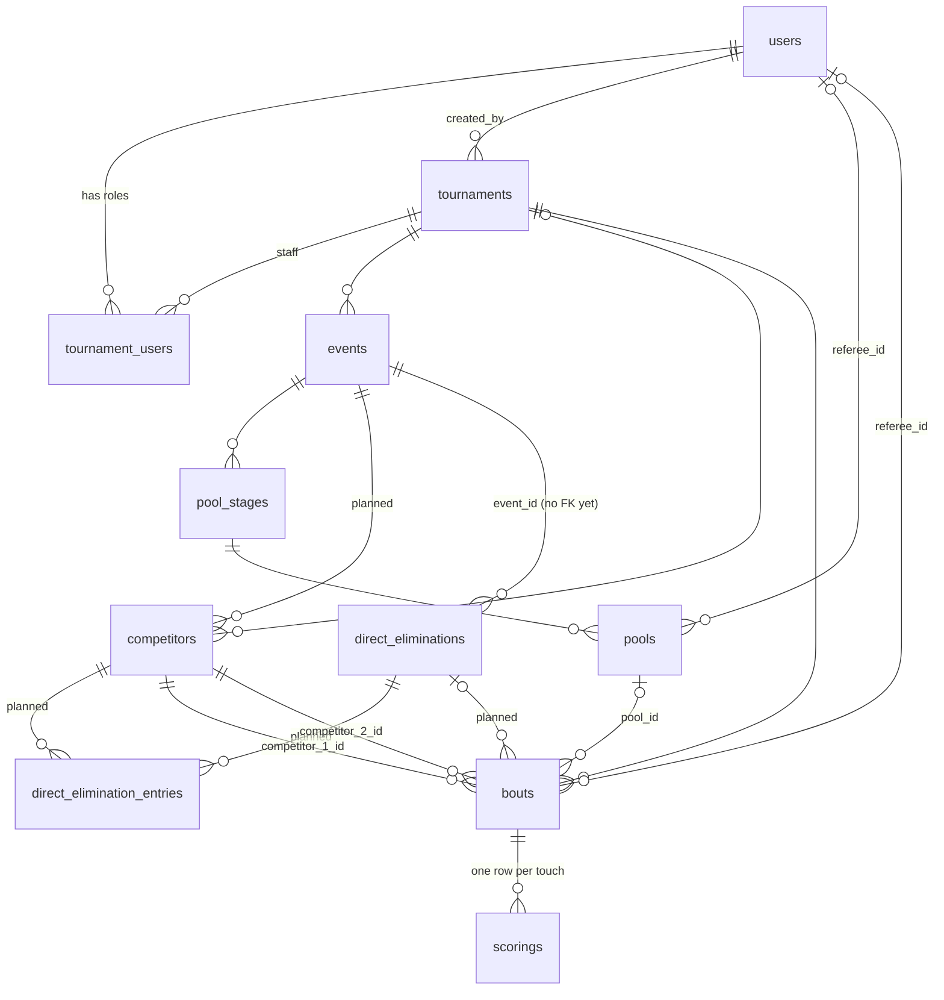

# Boutline design

Boutline runs fencing tournaments end to end: an organizer sets up a tournament and
its events, fencers are placed into pools, pool results seed a direct-elimination
tableau, and referees score every bout live from a phone while everyone else
follows along.

This document is the build plan. Each chapter is one step, in the order they are
built, and lists what must be true before the next step starts. The appendices
hold the reference material every step relies on: the domain model, API
conventions, concurrency rules and visual language.

Every chapter and subsection carries a status:

- **Completed**: built end to end against the real API. The section stays as the
  spec for how it behaves.
- **Partial**: some of it is built; the section says which part.
- **Planned**: specified here, not yet in code. Treat it as the proposed design and
  amend it through review.
- **Next in line**: wanted, but outside the current scope. It is the first thing
  picked up once the current scope is done.

Chapters 1–9 are the current scope; chapter 10 is next in line. A chapter's
"Done when" list gates the backend work of the next chapter. Frontend work against
placeholder data can run ahead of its chapter, and a chapter is Completed only once
its screens use the real API.

When code and this document disagree, fix one of them in the same PR.

---

## 1. Foundations

**Status:** Completed.

The schema for every entity, CRUD for each, login, the scoring API, the referee
screen and the public tournament list. Later chapters add rules on top of these.
Where a later chapter changes something here, the subsection links to it.

### 1.1 Users and roles

**Status:** Completed. Enforcing roles is §2.2.

| Role | Scope | Can |
| --- | --- | --- |
| Spectator / fencer | public, no account needed | browse tournaments, events, pools, tableau, results, live scores |
| Account holder | global | create tournaments, be added as staff |
| Tournament **admin** | one tournament | edit it, run its lifecycle, manage events, competitors, staff, pools, brackets |
| Tournament **referee** | one tournament | start, score and end bouts they are assigned to |

Roles are per tournament (`tournament_users.role`: `admin` | `referee`). There is no
global superuser. A user can hold different roles in different tournaments.

### 1.2 Accounts and authentication

**Status:** Completed.

#### 1.2.1 Users
- `users`: `id`, `email` (unique, lowercased, validated with `net/mail`), `password`
  (bcrypt, 1–72 bytes), `first_name`, `last_name`, timestamps.
- `GET /users?q=` (trigram search on full name), `GET /users/{id}`,
  `PATCH /users/{id}` (names only), `DELETE /users/{id}` (409 if the user created a
  tournament, referees a bout or pool, or recorded a touch; memberships cascade),
  `GET /users/{id}/tournaments` (tournaments the user is staff on).
- The password is never returned.

#### 1.2.2 Login
- `POST /api/v1/auth/signup` (409 on duplicate email) and `POST /auth/login` both
  return `{token, user}`. The token is a JWT carrying the user ID, valid 24 hours
  (`user.UserTokenTTL`).
- The auth middleware makes reads public and every other method require
  `Authorization: Bearer <token>`. An operation can override this; `GET /users` and
  `GET /users/{id}` require a token. The verified ID is read with `user.UserIDFrom`.

#### 1.2.3 Session in the frontend
The `login` and `signup` Server Actions call the backend and store the token in an
httpOnly, `sameSite=lax` cookie with the token's lifetime, so page scripts never see
it. `src/proxy.ts` moves the cookie into the `Authorization` header on `/api/*`, and
redirects `/admin/*` and `/…/referee` to `/login?next=…` when there is no cookie.

### 1.3 Tournaments

**Status:** Completed. Setup fields and lifecycle rules are §5.1; visibility is §2.3.

#### 1.3.1 Data
`tournaments`: `name` (1–120), `visibility` (`private` | `public`, default private),
`code` (unique 6-char join code), `status`, `created_by` (user), `start_time`,
`started_at`, `completed_at`.

#### 1.3.2 Join code
Six characters from `ABCDEFGHJKMNPQRSTUVWXYZ23456789`, which leaves out the
look-alikes 0/O and 1/I/L. Generated with `crypto/rand` and retried up to five times
on collision. Lookup is case-insensitive and trims whitespace:
`GET /tournaments/code/{code}`. Fencers and spectators join a private tournament by
typing the code.

#### 1.3.3 API (`/api/v1/tournaments`)
| Method | Path | Notes |
| --- | --- | --- |
| POST | `/` | create; the code is server-generated |
| GET | `/?q&status&limit&offset` | fuzzy name search, status filter |
| GET | `/{id}` | |
| GET | `/code/{code}` | join by code |
| PATCH | `/{id}` | name, visibility, start_time; 409 once ended |
| POST | `/{id}/start` | `pending → active` |
| POST | `/{id}/complete` | `active → end` |

Tournaments cannot be deleted (on purpose; soft delete is under consideration).

#### 1.3.4 Tournament list (`/tournaments`)
A server-rendered list with a search box (a plain GET form that works without JS;
with JS it updates `?q=` after a 300ms debounce), 20 per page, Previous/Next links,
a status badge (Upcoming / Active / Ended), and empty states for "no results" and
"no tournaments". Location is hardcoded as "City, Country" until §5.1 adds it, and
the Filter button is inert (#122).

### 1.4 Tournament staff

**Status:** Completed (API only). The Staff screen and guards are §5.3.

`tournament_users`: primary key `(user_id, tournament_id)`, `role`. The rows are
deleted when either the user or the tournament is deleted.

| Method | Path | |
| --- | --- | --- |
| POST | `/tournaments/{id}/users` | add `{user_id, role}`; 409 if already a member |
| GET | `/tournaments/{id}/users` | list |
| PATCH | `/tournaments/{id}/users/{user_id}` | change role |
| DELETE | `/tournaments/{id}/users/{user_id}` | remove |

### 1.5 Events

**Status:** Completed (CRUD). Attributes are §3.6; lifecycle and screens are §5.2.

`events`: `tournament_id`, `name` (1–200), `format` (only
`pool_then_direct_elimination`), `status`, `start_time`, `started_at`,
`completed_at`. Deleting an event also deletes its pool stages (but see §3.3).

`/api/v1/events`: `POST /` (tournament must exist), `GET /?tournament_id&status`,
`GET /{id}`, `PATCH /{id}` and `DELETE /{id}` (both only while `upcoming`).

### 1.6 Competitors

**Status:** Completed (CRUD). One competitor per event is §3.5.

`competitors`: `tournament_id` (nullable for now), `first_name`, `last_name`,
`rating` (`A`–`E`, `U` = unrated, default U), `team` (free-text club, `''` when
none). There is no clubs table: a club is the distinct `team` values.

`/api/v1/competitors`: `POST /`, `GET /?q&rating&team` (fuzzy name search),
`GET /{id}`, `PATCH /{id}` (an empty `team` clears it), `DELETE /{id}` (hard
delete; the only route that checks the caller's tournament role), and
`GET /search/teams?q&tournament_id`, which returns each club with its
`competitorCount`.

### 1.7 Pool stages and pools

**Status:** Completed (CRUD). Generation and results are chapter 6.

- `pool_stages`: `event_id`, `max_competitor_per_pool` (≥ 2), `status`, `start_time`.
- `pools`: `pool_stage_id`, `referee_id`, `started_at`, `completed_at`.
- `bouts.pool_id` links a pool's bouts to the pool.
- `/api/v1/pool-stages`: CRUD; edit and delete only while `upcoming`; delete is
  blocked once any of its pools has bouts.
- `/api/v1/pools`: CRUD; `PATCH` changes only the referee; delete is blocked
  (409) when the pool has bouts.

### 1.8 Direct elimination stage

**Status:** Completed (stage status only). The bracket is chapter 7.

`direct_eliminations`: `event_id` (no foreign key yet, §3.3), `status`,
`started_at`, `completed_at`. `/api/v1/direct-eliminations`: CRUD plus
`POST /{id}/start` (`upcoming → active`) and `/complete` (`active → ended`).

### 1.9 Bouts

**Status:** Completed. Result storage and server rules are chapter 4.

`bouts`: `tournament_id`, `pool_id?`, `referee_id?`, `competitor_1_id`,
`competitor_2_id` (must differ), `points_to_win` (> 0), `time_limit_seconds?`,
`location?` (strip number, max 200 chars), `group_number`, `start_time`,
`status`, `started_at`, `completed_at`.

| Method | Path | Rules |
| --- | --- | --- |
| POST | `/bouts` | tournament must be active; the pool must belong to the same tournament |
| GET | `/bouts?tournament_id&pool_id&status` | |
| GET | `/bouts/{id}` | |
| PATCH | `/bouts/{id}` | only while `upcoming` |
| POST | `/bouts/{id}/start` | tournament active, referee assigned, `upcoming → active` |
| POST | `/bouts/{id}/end` | `active → end` |
| DELETE | `/bouts/{id}` | only while `upcoming` or `end` (narrowed in §3.4) |

The **bout page** (`…/bout/[boutId]`) shows two score tiles, a "Referee view" button
and a touch log. It is fed by the placeholder fixture, but its referee link goes to
the real API.

### 1.10 Scoring API

**Status:** Completed. Server-side rules are §4.1.

`scorings`: `bout_id`, `competitor_id`, `points` (≥ 1, default 1), `created_by`,
`revoked_at`, `revoked_by`. A touch is never deleted. Undo sets `revoked_at`.

| Method | Path | |
| --- | --- | --- |
| POST | `/scoring` | award a touch |
| GET | `/scoring/{id}` | |
| PATCH | `/scoring/{id}` | change points or competitor; 409 if revoked |
| POST | `/scoring/{id}/revoke` | undo; 409 if already revoked (race-safe) |
| GET | `/scoring/match/{bout_id}?include_revoked` | live touches, paginated |
| GET | `/scoring/match/{bout_id}/history` | every touch, newest first, with running `competitor_1_score` / `competitor_2_score`; never paginated |

### 1.11 Referee screen (`…/bout/[boutId]/referee`)

**Status:** Completed, with a temporary bypass that §2.1 removes. This is the only
screen fully wired to the backend.

#### 1.11.1 Phases

| Phase | When | Referee sees |
| --- | --- | --- |
| `not-started` | bout `upcoming` | "Start match" |
| `scoring` | active, no winner | a large "Touch {name}" button per fencer, Undo, a match-point banner when a side is one touch away (both sides can be) |
| `confirming` | a side reached `points_to_win` | "{winner} wins A–B", one confirm button per fencer, Undo |
| `over` | bout `end` | the winner banner; no controls |

#### 1.11.2 Rules
- The score is the sum of a fencer's live (unrevoked) touches. The winner is the
  first side to reach `points_to_win` (§4.2 adds results at time and on priority).
- **One action in flight.** Touch, undo, start and end go through a single queue
  that refuses new input while a request is pending. Touches show immediately as
  "Saving…" rows (optimistic) and settle when the server replies.
- **Undo** revokes the most recent live touch, whichever fencer it belongs to.
  Available in `scoring` and `confirming`.
- **Two-party confirmation.** The bout ends only when both fencers have confirmed
  the same score. Each confirmation records the score version it was given
  against, so a touch or undo in between cancels earlier confirmations.
- **End guard.** The client refuses to end the bout if the number of touches it has
  confirmed differs from the tally it is ending on ("The score changed before the
  bout could end").
- **Recovery.** Any failed request shows an error, then reloads the bout, touches
  and history from the server, which wins.
- **History.** A newest-first log of time, "Touch {name}", running score
  (fencer 1 – fencer 2), with revoked touches kept and labelled "Revoked".
- Start assigns a referee if none is set, then starts the bout.

#### 1.11.3 Temporary bypass
The page sits behind the login gate, but it still sends a fixed seeded user
(`FALLBACK_SCORER_ID`, Alex Morgan) as scorer and referee instead of the logged-in
user. The real referee checks are commented out with TODOs. **Any logged-in user
can score any bout** until §2.1 and §2.2 ship.

### 1.12 Pinning

**Status:** Completed (state and batch fetch). The `/pinned` page is a scaffold.

A viewer can pin fencers and bouts to follow them. Pins live in the browser's
`sessionStorage`, never in the database. The pinned view fetches each entity type
in one request with the `ids` filter on `/competitors` and `/bouts` (§B.1).

---

## 2. Identity and access

**Status:** Planned.

**Done when:**
- No route takes the acting user from the request body.
- Every mutating route checks the caller's tournament role.
- A private tournament's data cannot be read without staff membership or its code.
- Login and the join-code lookup are rate-limited.

Pool generation (chapter 6) must not ship before this chapter: it would otherwise
let any logged-in user reseat another tournament's pools.

### 2.1 Actors from the session

**Status:** Planned. Issue: #184.

- `created_by` (tournament, scoring), `revoked_by` and the acting referee come from
  `UserIDFrom`, not the request body. Today all three are client-supplied.
- `PATCH` and `DELETE /users/{id}` only for the caller's own ID (403 otherwise).
  Today any logged-in user can rename or delete any other user.
- The referee screen drops `FALLBACK_SCORER_ID` (§1.11.3) and restores its
  commented-out referee checks.

### 2.2 Role checks

**Status:** Planned. Issue: #4.

- Authorization helper `requireRole(tournamentID, admin|referee)` on every mutating
  route. Today only competitor delete checks a role; any logged-in user can start,
  end, edit or delete tournaments, events, pools, pool stages and bouts.
- The creator becomes an `admin` member automatically on create (today they don't).
- Starting, scoring and ending a bout requires the `referee` role and being the
  bout's assigned referee (open question in §D).
- Guard against removing or demoting the last admin.

### 2.3 Visibility

**Status:** Planned. Issues: #46, #187.

- Private tournaments are hidden from the public list and readable only by staff
  or by someone holding the code.
- The check covers every read that returns tournament data, not just the
  tournament routes. `/events`, `/competitors`, `/bouts`, `/scoring/…` and the pool
  and DE routes are top level and don't require a tournament filter. Today
  `GET /competitors?q=` searches every tournament at once.
- Holding the code is remembered in a cookie listing the tournament IDs the viewer
  unlocked.

### 2.4 Rate limits

**Status:** Planned. Issue: #188.

Login and `GET /tournaments/code/{code}` are rate-limited per IP (and, for login,
per email) in Redis, returning 429 with `Retry-After`. There are about 887M join
codes, few enough to enumerate without a limit.

### 2.5 Credentials

**Status:** Planned. Issue: #176.

Email and password change (TODO in `user/types.go`), and stronger password
requirements than the current 1–72 bytes.

---

## 3. Schema corrections

**Status:** Planned.

**Done when:** every migration below has landed, so chapters 4–7 build on the final
shape of the tables.

### 3.1 Status vocabulary

**Status:** Planned. Issue: #86.

Tournaments and bouts end in `end`, everything else in `ended`. Unify to `ended` in
one migration.

### 3.2 JSON casing

**Status:** Planned.

Tournament, event, bout and scoring responses are snake_case; user and competitor
are camelCase. Pick one before the frontend reads more of them.

### 3.3 Event deletion and the DE foreign key

**Status:** Planned. Issue: #182.

- Deleting an upcoming event removes its pool stage, pools, their bouts and its DE
  in one transaction. Today the cascade stops at `bouts.pool_id`
  (`ON DELETE RESTRICT`), so deleting an upcoming event that already has pools fails
  with a 500.
- Add the FK `direct_eliminations.event_id → events`. Without it the DE row is left
  behind when its event is deleted.

### 3.4 Bout deletion

**Status:** Planned. Issue: #183.

- A bout that belongs to a pool or a tableau is never deletable. Its parent creates
  and removes it, and deleting an ended one would rewrite pool results or strand
  the bracket.
- A free-standing bout is deletable only while `upcoming`.
- FK errors become 409s. Deleting a bout with touches, or a competitor that appears
  in a bout, returns a 500 today.

### 3.5 One competitor per event

**Status:** Planned. Issue: #77.

- A competitor row belongs to exactly one event (`event_id`, required). A person
  fencing foil and épée has two rows, one per event. Because ratings are per
  weapon (`B24` in foil, `U` in épée), each row carries its own rating, seed and
  check-in. There is no entries table.
- New columns: `event_id`, `gender`, `birthdate`, `primary_club` and
  `secondary_club` (both nullable), `division` (home state), `member_number`
  (optional, unique within an event; its authority comes from the tournament),
  `rating_year` (e.g. 24 in `C24`), `seed`, `checked_in_at`, `withdrawn_at`.
  `team` is deprecated in favour of `primary_club`.
- `tournament_id` stays on the row, set on create, so tournament-wide lists don't
  need a join. Lists filter by tournament and event (neither is possible today).
- Club names are free text, so "NYAC" and "New York AC" count as two clubs. Club
  separation (§6.2) and the Clubs tab compare a normalised key (case, whitespace
  and punctuation folded) until there is a clubs table (#12).
- Competitors are not linked to users. A nullable `competitors.user_id` would let a
  fencer follow their own bouts, and let the referee check refuse a user who is
  fencing in the bout.

### 3.6 Event attributes and bout settings

**Status:** Planned. Issue: #186 (touches and time).

Event attributes the creation form already collects, to add as columns:

| Field | Values |
| --- | --- |
| type | individual, team |
| weapon | foil, épée, sabre |
| gender | men, women, mixed (both boxes checked) |
| age category | Y8, Y10, Y12, Y14, Cadet, Junior, Senior, Veteran, Open |
| rating limit | e.g. "D and under", "Open" |
| seeding | by rating, by ranking points, random |
| format | `direct_elimination` (new), `pool_then_direct_elimination` |
| qualifier | boolean |
| fees, referees | money; list of referee users |
| pool touches, pool time | default 5 touches, 180 s |
| DE touches, DE periods | default 15 touches, three 180 s periods; youth and veteran events often fence DE to 10 |

Generated bouts copy their touches and time limit from the event, so chapters 6
and 7 never hardcode them.

### 3.7 Freezing ended tournaments

**Status:** Planned.

`end` freezes only the tournament row. Its events, staff and competitors stay
editable. Block writes to all of them once the tournament has ended.

### 3.8 Small fixes

**Status:** Planned.

- `GET /scoring/match/{id}` sorts newest first; its description says "in the order
  they were recorded".
- With `points_to_win = 1`, both fencers show as on match point at 0–0.

---

## 4. Bout integrity

**Status:** Planned.

**Done when:**
- The server, not the referee screen, decides when a bout is over and who won.
- An ended bout's result can only change through an admin correction.
- Ending a bout and running its parent's transition happen in one locked
  transaction, with a concurrency test that ends two sibling bouts at once.

### 4.1 Server-side scoring rules

**Status:** Planned. Issue: #179.

- Reject touches, edits and revokes on bouts that are not `active` (409), and
  touches for competitors outside the bout (400). Add the missing FK on
  `scorings.competitor_id`.
- Refuse a touch, or a points edit, that would take a side past `points_to_win`.
- Idempotency: a client-generated `request_id` on `POST /scoring` (unique per bout),
  so a retried touch is not double-counted.

Today only the client enforces any of this: the server accepts touches on upcoming
and ended bouts, and a touch revoked after the bout ends silently changes its
result. Pool re-seat (§6.2) depends on this: it regenerates `upcoming` bouts, which
fails on the scorings FK while they can hold touches.

### 4.2 Bout result

**Status:** Planned. Issues: #178, #14.

The winner can't always be read off the touches: a bout can end at time with no one
at `points_to_win`, on a priority minute with the score tied, or by forfeit with no
touches at all. So `/end` stores the result on the bout:

| Column | Meaning |
| --- | --- |
| `winner_id` | one of the two competitors; required once `end` |
| `competitor_1_score`, `competitor_2_score` | the live touch totals at the moment it ended |
| `end_reason` | `touches`, `time`, `priority`, `forfeit` |
| `annulled_at` | set when a withdrawal annuls the bout (§6.4) |

`/end` takes the winner and reason, and checks them against the live tally under
the bout row lock:

| Reason | Requires |
| --- | --- |
| `touches` | the winner is at `points_to_win` |
| `time` | the winner is ahead |
| `priority` | nothing about the score; a tie is allowed |
| `forfeit` | nothing |

Pool results, DE advancement and placings read these columns, never a fresh sum of
touches. The referee screen keeps two-party confirmation as UX, and gains a way to
end at time or on priority. Until the bout clock (chapter 10), the referee keeps
time separately and picks the reason by hand.

### 4.3 Bout constraints

**Status:** Planned.

- A CHECK makes `pool_id` and `direct_elimination_id` mutually exclusive.
- Both competitors must belong to the bout's event (§3.5), and the referee must be a
  staff member of its tournament.

### 4.4 Result correction

**Status:** Planned. Issues: #180, #17.

`POST /bouts/{id}/correct`, admin only, replaces an ended bout's scores and winner
and records who changed it, from what, and why. This is the one exception to
forward-only lifecycles (§A.2); no status moves backwards.

- A pool bout can be corrected until the DE is drawn, since the draw freezes the
  ranking (§7.2).
- A DE bout can be corrected while its next-round bout is still `upcoming`. That
  bout is rebuilt with the corrected winner in the same transaction.

### 4.5 Parent-row locking

**Status:** Planned. Issue: #181.

The shared mechanism for derived transitions (§B.2): ending a bout locks its
parent row (`SELECT … FOR UPDATE` on the pool stage or DE) and runs the parent's
transition before committing. Chapters 6 and 7 plug their transitions into it.

---

## 5. Tournament and event setup

**Status:** Planned. The screens exist as placeholders.

**Done when:**
- An organizer can create a tournament with its events, fencers and staff from the
  creation form.
- They can check fencers in and start the tournament, all against the real API.

### 5.1 Tournament fields and lifecycle

**Status:** Planned.

- Fields the creation form already collects but the backend lacks: location
  (city/state), venue, fees, sanctioning authority (askFRED, USA Fencing, FIE,
  Other), description. Add them to `tournaments`.
- Starting a tournament requires at least one event. Completing it requires every
  event to be `ended` or `cancelled`, so an event that never ran doesn't block it.

### 5.2 Event lifecycle and screens

**Status:** Planned.

- An event is created together with its stages: a `pool_then_direct_elimination`
  event gets one `pool_stage` and one `direct_elimination`; a `direct_elimination`
  event gets only the DE.
- Event status follows its stages: `active` when the first stage starts, `ended`
  when the DE completes. `cancelled` is set by an admin while `upcoming`. Today
  events have no transitions, so `active` and `ended` are unreachable.
- **`/tournaments/[id]/events`** (placeholder: four hardcoded events): gains search
  and a weapon/gender/age filter, and shows Past / Live / Upcoming from `status`.
- **`/tournaments/[id]/events/[eventId]`** redirects to the Fencers tab. Tabs are
  Pooling · Fencers · Tableau · Results. The event Fencers tab is static text today.

### 5.3 Staff

**Status:** Planned. Issues: #16, #20.

- The creation form's free-text "Admins" field (comma-separated emails) resolves
  emails to users and adds them as admins.
- A Staff screen under the tournament for admins.
- Block staff changes once the tournament has ended (§3.7).

### 5.4 Import

**Status:** Planned. Issues: #80, #84, #85.

The dropzones on the creation form take askFRED and USA Fencing CSV/XML exports and
create one competitor row per event entered, with name, club and rating. Parsing an
upload into a preview is built in the frontend (#123); committing it is not.

### 5.5 Check-in

**Status:** Planned.

Admins mark fencers present (`checked_in_at`). Only checked-in fencers are placed
into pools.

### 5.6 Tournament screens

**Status:** Planned. Placeholders exist.

- **`/tournaments/[id]`**: tabs Overview · Fencers · Clubs · Events. Overview shows
  name, venue, date and time, contact, the live events, and a join-code prompt for
  private tournaments. None of it calls the API yet.
- **Fencers tab**: a searchable list with rating and club. It lists people, not
  rows, so it groups a person's rows across events by `member_number`, falling
  back to name and primary club when it is missing.
- **Clubs tab**: clubs with counts, which drill down to their fencers.

### 5.7 Organizer console

**Status:** Planned. Issue: #136. Placeholders exist.

- **`/admin`**: a hub with "View tournaments" and "New tournament", plus inert menu
  buttons (tools, reports, view, save).
- **`/admin/tournaments`**: three hardcoded tournaments; reads
  `GET /users/{me}/tournaments` instead.
- **`/admin/tournament/new`**: a full form for tournament fields (§5.1), import
  dropzones (§5.4), admins (§5.3), and any number of event blocks (§3.6). Today
  submit discards the data and navigates away, the dropzones ignore their files,
  and events cannot be removed.

Submit creates the tournament, then its events, then imports competitors and adds
staff. It shows per-row errors and lands on the new tournament. On the day, the
admin runs check-in, starts the tournament, generates pools (which creates bouts,
so it needs the tournament `active`), assigns referees, and generates the DE once
pools end.

---

## 6. Pools

**Status:** Planned.

**Done when:**
- An admin can generate, adjust and save pools for an event.
- Referees fence them, and the pool stage ends by itself with a final ranking.
- Withdrawals don't stall it.

### 6.1 Pool data

**Status:** Planned.

- `pools.number` (≥ 1, unique per pool stage) labels the pool, and `pools.strip`
  is its strip assignment.
- `bouts.slot` (≥ 1, unique per pool) is a pool bout's place in the pool's bout
  order. Bouts created in one batch share a `created_at`, so the order needs a
  column. The same column holds a DE bout's bracket position (§7.1).
- A pool's fencers are the competitors in its bouts. There is no pool-fencers
  table.
- A pool's bouts copy its strip (`location`), referee and number (`group_number`).
  Editing any of those on the pool updates its upcoming bouts in the same
  transaction, so they never go stale.

### 6.2 Pool generation

**Status:** Planned. Issues: #56, #153.

Generation is three steps, all admin only and only while the pool stage is
`upcoming`. The admin reviews and adjusts the proposal before anything is saved.
Creating pools creates bouts, which requires an `active` tournament (§1.9), so
pools are generated after the tournament starts.

1. **Propose:** `POST /pool-stages/{id}/proposed-pools` takes the event's
   checked-in fencers (an optional `competitor_ids` overrides the list, and every
   id must belong to the event) and returns pools without saving:
   - Seed by the event's `seeding` rule (rating, then rating year, then random
     tiebreak).
   - Pool count = `ceil(n / max_competitor_per_pool)`, with sizes as equal as
     possible (e.g. 20 fencers, max 7: pools of 7-7-6). Today
     `max_competitor_per_pool` is stored but nothing reads it.
   - `n < 2` is a 400: a pool needs two fencers. `max_competitor_per_pool` is capped
     at 12, the largest size with a standard bout order.
   - Snake the seeds across the pools (1→A, 2→B, 3→C, 4→C, 5→B, …).
   - **Club separation:** move fencers between pools at the same seeding level to
     minimise same-club pairs within a pool, comparing normalised club names
     (§3.5).
2. **Create:** `POST /pools` takes the adjusted pools and creates each one with
   every round-robin bout, in the standard bout order for its size so no one
   fences back-to-back. Pool bouts use the event's pool touches and time (§3.6).
3. **Re-seat:** `PATCH /pools/{id}` with `fencers` replaces a pool's fencers and
   regenerates its bouts, while none of them has started. Depends on §4.1.

Create and re-seat lock the pool stage row (`SELECT … FOR UPDATE`) and run every
check inside that transaction. Without the lock, two requests can seat the same
fencer in two pools, or re-seat a pool that has just started.

### 6.3 Pool results

**Status:** Planned.

`GET /pool-stages/{id}/results` returns each pool's grid and standings plus the
overall ranking, computed from ended bouts. It is also the read the Pools tab
uses, so there is no separate pool-board resource.

| Column | Meaning |
| --- | --- |
| V | victories |
| M | bouts fenced |
| V/M | win ratio, the primary sort key |
| TS / TR | touches scored / received |
| Ind | indicator = TS − TR, the second sort key |

Overall ranking: V/M desc, then Ind desc, then TS desc, otherwise tied. That
ranking seeds the DE, so the results endpoint and the DE draw (§7.2) share one
standings function.

V comes from `bouts.winner_id` (§4.2), not from comparing scores. A bout won at
time can be `V3`–`D2`, and a priority win can be `V2`–`D2`.

### 6.4 Withdrawal during pools

**Status:** Planned. Issue: #185.

`competitors.withdrawn_at` marks a fencer who leaves the event: injury, a black
card (§9.2), or a no-show after check-in. Every bout of theirs is then annulled,
fenced or not. `bouts.annulled_at` is set, the bout is left out of everyone's V, M,
TS and TR, and the fencer leaves the overall ranking. An annulled bout keeps its
status, and counts as finished so the stage can still end.

### 6.5 Pool stage lifecycle

**Status:** Planned. Depends on §4.5.

- The stage becomes `active` when its first bout starts.
- It ends when every bout in it is `end` or annulled, and it has at least one pool.
  The check runs under the stage row lock in the transaction that ends the bout.
- Pools have no status column. A pool's state is derived from its bouts; its
  `started_at` / `completed_at` are written when its first bout starts and its last
  one finishes.

Today pool stages have no transitions, so `active` and `ended` are unreachable.

### 6.6 Pooling tab and pool screen

**Status:** Planned. Issue: #127.

The Pooling tab lists each pool's bouts (round, names, score) linking to each
bout. Today it is a hardcoded fixture shared by every event. Each pool screen shows
the classic grid (fencer × fencer, `V5` / `D3` cells) plus the summary columns,
from §6.3.

---

## 7. Direct elimination

**Status:** Planned.

**Done when:**
- An admin can draw a tableau from the pool ranking.
- Each bout's winner advances as soon as the next bout's other fencer is known.
- The final completes the DE and the event, and the Tableau tab shows it all live.

### 7.1 Bracket data

**Status:** Planned.

- `direct_elimination_entries(direct_elimination_id, competitor_id, seed)`: the
  fencers who made the cut, with `seed` unique within a tableau. They are written
  once at the draw and never recomputed, so a pool score corrected afterwards
  cannot move anyone, and they are the only record of who has a bye. They are
  stored rather than recomputed from the pool ranking so an organizer can leave
  out a fencer who withdraws after pools, or correct a seed, without touching
  pool results.
- `bouts.direct_elimination_id` and `bouts.round_size` (fencers in the round: 64,
  32, …, 2 is the final). A DE bout reuses `bouts.slot` (§6.1) as its 1-based
  position in the round, top to bottom, with `competitor_1` as the top fencer. The
  bouts at slots 2k−1 and 2k feed slot k of the next round.
  `(direct_elimination_id, round_size, slot)` is unique.

### 7.2 Draw

**Status:** Planned.

`POST /direct-eliminations/{id}/generate`, admin only, while `upcoming`, and only
once the event's pool stage has ended:

- It takes the pool ranking, applies an optional cut (e.g. advance the top 80%),
  breaks remaining ranking ties at random, and writes the entries.
- Fencers tied at the cut line all advance, so the cut can let in more than its
  percentage. The random tiebreak runs only after the cut.
- `n < 2` after the cut is a 400. One fencer has no final to fence, so the DE would
  never complete.
- The bracket size is the next power of two ≥ n. Seeds are placed in standard
  bracket order (1 v 64, 32 v 33, …), and the top seeds receive byes for the empty
  positions.
- The draw creates only first-round bouts, one per position with two fencers; a bye
  has no bout. A DE bout is only ever created with both fencers known, so
  `competitor_1_id` and `competitor_2_id` stay required.
- DE bouts use the event's DE touches and periods (§3.6), with a 1-minute break.

### 7.3 Advancement

**Status:** Planned. Issue: #181. Depends on §4.5.

- A next-round bout is created as soon as both of its feeders are known: the
  winners of the bouts at slots 2k−1 and 2k, or a bye fencer and one winner in the
  second round. Waiting for the whole round would hold up every fencer behind the
  slowest bout.
- Advancement runs in the transaction that ends the bout, under the DE row lock, so
  a crash cannot end a bout without advancing its winner, and two neighbouring
  bouts ending at once cannot both miss the other's result. The insert uses
  `ON CONFLICT DO NOTHING` on the unique slot index.
- A DE bout can only start while its DE is `active`.
- A fencer who withdraws during the DE loses their current bout by forfeit (§4.2),
  and their opponent advances.

### 7.4 Completion and placings

**Status:** Planned.

- The final ending completes the DE and the event. `POST /{id}/complete` is refused
  (409) while the final has not ended.
- Final placings: 1, 2, 3 and 3 (no bronze bout), then by round of elimination,
  ties within a round broken by seed.

### 7.5 Tableau endpoint and tab

**Status:** Planned. Issues: #156, #100, #168.

- `GET /events/{id}/tableau` (public) returns every round from the bracket size
  down to the final, each with its bouts in slot order and each fencer's seed.
  Rounds not yet created come back with no bouts.
- The Tableau tab shows the bracket by round, with live scores on active bouts.
  Positions without a bout (byes, rounds not yet created) are drawn empty. Today it
  shows the placeholder bout list from Pooling.

---

## 8. Results

**Status:** Planned. Issue: #129.

**Done when:** every ended event shows its final placings, and an admin can export
them.

### 8.1 Placings

**Status:** Planned.

`GET /events/{id}/results` returns the final placings (from the DE, §7.4, or from
the pool ranking for fencers cut after pools) with name, club, rating and place.

### 8.2 Export

**Status:** Planned.

Admins export placings in askFRED / USA Fencing format.

### 8.3 Results tab and podiums

**Status:** Planned.

The Results tab (static today) shows the table, and the tournament overview links
each ended event's podium.

---

## 9. Match features

**Status:** Planned.

**Done when:**
- Spectators see scores update without reloading.
- Referees can record cards, épée doubles and abandonments.

### 9.1 Live updates

**Status:** Planned. Issues: #13, #102.

Spectators follow bouts through SSE or polling against `/history`. Redis is
already connected and is the obvious pub/sub channel.

### 9.2 Cards

**Status:** Planned.

Yellow (warning), red (penalty touch to the opponent) and black (exclusion),
recorded as scoring rows with a `kind`. A yellow card is worth no touches, so the
`points ≥ 1` check applies only to `touch` and `red`, and the score sums only those
kinds. A black card withdraws the fencer from the event (§6.4, §7.3).

### 9.3 Double touches

**Status:** Planned.

In épée, one action awards both fencers. A double at one touch from the end (4–4,
14–14) cannot produce a winner the "first to `points_to_win`" rule understands
(§D).

### 9.4 Forfeit and abandonment

**Status:** Planned.

The referee screen can end a bout by forfeit or abandonment, which records
`end_reason = forfeit` (§4.2) and, for an injury, withdraws the fencer.

---

## 10. Bout clock

**Status:** Next in line. Wanted, but outside the current scope.

Until it ships, the referee keeps time separately and ends a bout at time or on
priority by hand (§4.2).

- Start/stop, and a `time_limit_seconds` countdown.
- Periods and the 1-minute break for DE bouts (§3.6).
- At time with a tied score, priority is assigned at random and the bout goes one
  more minute.

---

## Appendix A. Domain model

### A.1 Entities

Links labelled "planned" come from one competitor per event (§3.5) and the bracket
(§7.1).

| Entity | Meaning |
| --- | --- |
| **User** | a person with an account (organizer, referee) |
| **Tournament** | a dated competition with a join code, e.g. "Boston Fall Open" |
| **TournamentUser** | a user's staff role in one tournament |
| **Event** | one competition inside a tournament, e.g. "Y14 Men's Foil" |
| **Competitor** | a fencer entered in one event, with that weapon's rating, club, seed, check-in and withdrawal (one row per event is planned; today rows belong to a tournament) |
| **PoolStage** | the round-robin round of an event |
| **Pool** | one group of fencers within a pool stage, with a referee |
| **DirectElimination** | the knockout round of an event |
| **DirectEliminationEntry** | a fencer who made the cut into a tableau, with their seed (planned) |
| **Bout** | one match between two competitors |
| **Scoring** | one touch awarded in a bout. Undo marks it revoked, never deletes it |

All IDs are UUIDs except `scorings.id` (bigserial, so touches sort by insert order).

### A.2 Lifecycles

Every stateful entity moves forward only. Transitions are guarded in SQL
(`UPDATE … WHERE status IN (…)`), so two racing requests cannot both succeed; the
loser gets `409`. The one exception is result correction (§4.4), which amends an
ended bout without moving any status backwards.

| Entity | States | Transitions | Where |
| --- | --- | --- | --- |
| Tournament | `pending → active → end` | `POST /tournaments/{id}/start`, `/complete` | Completed (§1.3); rules in §5.1 |
| Event | `upcoming → active → ended`, or `upcoming → cancelled` | derived from its stages; cancel by an admin | §5.2 |
| PoolStage | `upcoming → active → ended` | derived from its bouts | §6.5 |
| Pool | no status column | derived from its bouts | §6.5 |
| DirectElimination | `upcoming → active → ended` | `POST /direct-eliminations/{id}/start`, `/complete` | Completed (§1.8); completion in §7.4 |
| Bout | `upcoming → active → end` | `POST /bouts/{id}/start`, `/end` | Completed (§1.9); result in §4.2 |

What each state allows:

- **Tournament**: name, visibility and start time are editable while `pending` or
  `active`. Bouts can only be created and started while `active`. `end` freezes the
  tournament row (and its children once §3.7 ships).
- **Event / PoolStage**: editable and deletable only while `upcoming`.
- **DirectElimination**: editable while `upcoming` or `active`.
- **Bout**: editable only while `upcoming`. Starting a bout requires an active
  tournament and an assigned referee. Deletion rules are §3.4.

`end` vs `ended` is unified in §3.1.

---

## Appendix B. Cross-cutting

### B.1 API conventions
- Routes live under `/api/v1`, except `/healthcheck`. The OpenAPI spec is at
  `/openapi.json` and Swagger UI at `/docs`.
- Errors are RFC 9457 problem details. `400` invalid input from the service, `422`
  schema validation from Huma, `404` not found, `409` conflict or duplicate, and
  `500` with a generic message for anything else.
- Lists return `{data, total, limit, offset}`; `limit` defaults to 20 (max 100).
  The scoring history is the exception: always complete, never paginated. An
  `ids` filter (up to 100, e.g. a viewer's pinned items) returns every listed row,
  so its `limit` defaults to the number of ids rather than 20.
- Fuzzy search uses `pg_trgm` `word_similarity` on names and clubs. Terms shorter
  than 2 characters fall back to a prefix `ILIKE`.
- The frontend talks to the API through `apiRequest` (`/api/v1` is proxied by
  `next.config.ts`). Server Components fetch with `no-store`.

### B.2 Concurrency
Network code must survive retries and races:
- State transitions are conditional updates, as described in §A.2.
- Revoke and edit of a score are conditional on `revoked_at IS NULL`.
- No version columns, idempotency keys or transactions exist yet. Multi-step
  operations such as pool generation and DE advancement **must** run in one
  transaction.
- Derived transitions (a pool stage ending when its last bout ends, a DE bout
  created when its feeders end, an event ending with its DE) are checks of the form
  "are all the siblings done?". A conditional update can't protect them, because
  each request only writes its own bout: two bouts ending at once can each see the
  other still active and both skip the transition, which stalls the parent for
  good. So they lock the parent row first (§4.5).
- Inside a transaction, an expected duplicate uses `ON CONFLICT DO NOTHING`. A
  raised unique violation aborts everything before it in the transaction.

### B.3 Infrastructure
Postgres (schema owned by Atlas migrations generated from the GORM models), Redis
(connected; first used by §2.4), Docker dev stack (`make dev-up`), seeds at
`backend/seeds/seed.sql` (fixed UUIDs, idempotent).

---

## Appendix C. Visual language

The UI is a **lofi** pass: monochrome, outlined, light mode only. Polish comes later
through the tokens, so components use tokens, never raw colors.

### C.1 Layout
- Mobile-first, one column:
  `mx-auto flex w-full max-w-mobile flex-col gap-10 px-4 py-10` (`max-w-mobile` is
  440px).
- Spacing: `gap-1`/`gap-2` inside a control, `gap-3`/`gap-4` between items in a list
  or section, `gap-10` between page sections.
- Group content with `Section`, whose title is a small uppercase muted label.

### C.2 Color tokens (`src/app/globals.css`)
| Token | Use |
| --- | --- |
| `background` / `foreground` | page and text; `foreground` is also the outline color |
| `muted` / `muted-foreground` | hover fills, secondary text, empty states |
| `selected` (blue) | only a chosen state: filled button, toggle on, active tab |
| `destructive` | errors and destructive actions |
| `border`, `input`, `ring` | hairlines, field borders, focus rings |

No Tailwind palette colors. The tournament status badge breaks this today
(`bg-amber-600`, `bg-emerald-600`); status colors become tokens next time it is
touched.

### C.3 Type
Geist Sans; Geist Mono for aligned numbers. Body and controls `text-sm`, metadata
`text-xs text-muted-foreground`, at most `font-medium`. Sizes from `text-2xl` up are
reserved for scores and bout banners. Referee scores go up to `text-9xl`.

### C.4 Shape and interaction
- `--radius` 0.625rem, with `rounded-sm`…`rounded-xl` derived from it. List cards
  use `rounded-md`; pills (tab nav, icon buttons, avatars) use `rounded-full`. 1px
  `border-foreground`, no shadows.
- Focus `focus-visible:ring-2 ring-ring`; hover `bg-muted`; disabled `opacity-50`.
- Icons from `lucide-react` at `size-4`, `aria-hidden` when decorative.
- Referee touch targets are large (`h-32`), because they are pressed under time
  pressure.

### C.5 Components
Primitives live in `src/components/primitives/`: shadcn-generated, restyled, `cva`
variants, `cn`, `data-slot`, behavior from `radix-ui`. A component used by one route
stays in that route's `_components/` until a second route needs it.

---

## Appendix D. Open questions

- Hi-fi design: brand color, dark mode, and whether `selected` stays blue.
- Desktop layouts for the organizer console, which may outgrow 440px.
- Team events (relay scoring to 45) are in the form but have no model.
- Do spectators need accounts (to follow fencers) or stay anonymous?
- Should ratings and rankings come from a USA Fencing lookup instead of import?
- Does the Pools tab show a start time per pool? If not, pools need no
  `start_time` of their own.
- Épée double touch at one touch from the end (4–4, 14–14): annul it, or allow
  5–5? The current rules give a bout no winner in that case, so the scoring
  rules and the `confirming` phase have to pick one.
- May a tournament admin referee and score bouts, or only users with the
  `referee` role?
- Does withdrawing a fencer after the DE draw but before their first bout give
  the opponent a walkover bout, or a bye?
